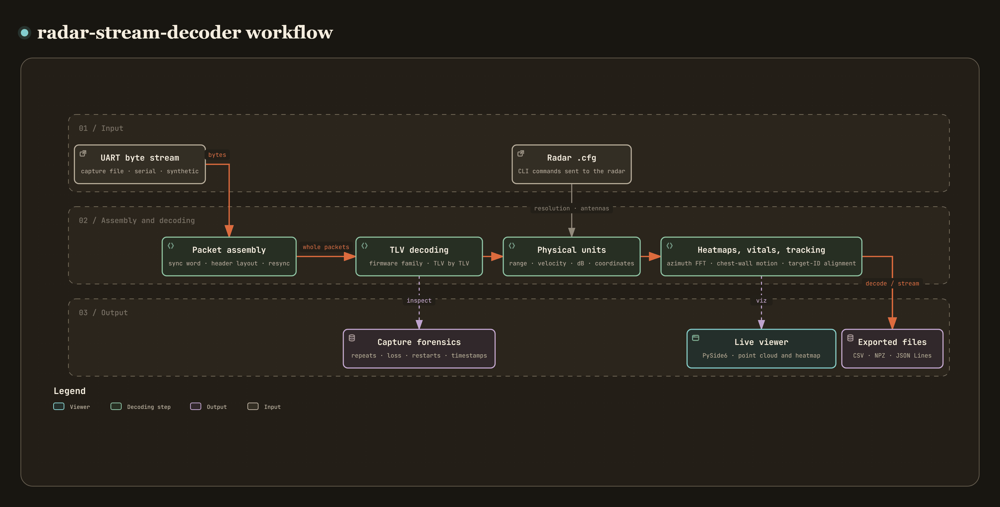

# radar-stream-decoder

[](https://github.com/recklight/radar-stream-decoder/actions/workflows/ci.yml)
[](https://www.python.org/downloads/)
[](LICENSE)

English | [繁體中文](README.zh-TW.md)

A decoder for the UART data stream (Type-Length-Value packets) of TI mmWave radars.

The Python package `radar_stream_decoder` and its command-line tool `radar-stream-decoder` take the bytes a TI millimeter-wave radar (IWR14xx, IWR16xx, IWR18xx, IWR68xx and others) sends from its data port and turn them into NumPy data with physical units. That covers the detected point cloud (range, Doppler velocity, azimuth, elevation, SNR), the range profile, the noise profile, the range-Doppler heatmap, the azimuth heatmap, processing statistics and the Vital Signs summary. The people counting and people tracking firmware add the target list tracked on the sensor, the target each point belongs to, and presence. It reads offline capture files or streams live from the serial ports, and comes with a PySide6 live viewer.

Author: RL

---

## Contents

- [Overview](#overview)
- [Supported firmware formats and verification](#supported-firmware-formats-and-verification)
- [Where TI's documents and firmware disagree](#where-tis-documents-and-firmware-disagree)
- [Method](#method)
- [Installation](#installation)
- [Quick start](#quick-start)
- [Usage examples](#usage-examples)
- [CLI reference](#cli-reference)
- [Graphical interface](#graphical-interface)
- [Project structure](#project-structure)
- [Data preparation](#data-preparation)
- [Configuration files](#configuration-files)
- [Results and metrics](#results-and-metrics)
- [Known limitations](#known-limitations)
- [Design notes](#design-notes)
- [Development and testing](#development-and-testing)
- [Vendor technical documents](#vendor-technical-documents)
- [References](#references)
- [License](#license)

---

## Overview

[](https://raw.githack.com/recklight/radar-stream-decoder/master/docs/workflow.html?theme=dark)

Interactive workflow diagram: [view it online](https://raw.githack.com/recklight/radar-stream-decoder/master/docs/workflow.html?theme=dark), or open [`docs/workflow.html`](docs/workflow.html) in a browser. You can zoom, search for nodes and trace the path between any two steps.

The out-of-box demo and the lab firmware of TI's mmWave radars all pack the processing result of each frame into one packet and send it from the data port: an 8-byte sync word, a header, then a number of TLVs (type, length, payload). The format is simple. Decoding it reliably is harder, for four reasons:

- TLV type numbers depend on the firmware. Type 1 is the detected points in the out-of-box demo but a complex range segment in the Vital Signs lab; type 6 is the processing statistics in the out-of-box demo but the point cloud in the people counting lab. The firmware family has to be known (or worked out) before decoding.
- There is more than one header layout. The out-of-box demo header is 36 or 40 bytes; whether the trailing sub-frame field is there depends on the platform and the SDK version, and the header does not say. The 3D People Counting lab uses 48 bytes and the 2D people counting lab 52 bytes. The two order their fields differently, and unlike the out-of-box demo both carry a checksum and count the 8-byte type and length in each TLV length. The SDK version word cannot tell them apart: the 3D People Counting lab writes the SDK 3.5 version word as well.
- Integrity checks are limited. Out-of-box demo packets have no CRC, and the people counting labs only checksum the header. A serial overrun cuts packets short, the receiver may start reading in the middle of a packet, and a recorder may write its whole buffer to the file again and again, so integrity mostly rests on structural checks.
- Without the radar configuration there are no physical units, and even with it there are conventions to choose. Range, velocity and the dB scale all derive from the `.cfg` sent to the radar; which frequency gives the wavelength, and whether the maximum range is cut to 80%, differ between TI's visualizer and the firmware. The timestamp is a 32-bit CPU cycle count that wraps around, and the 48-byte header has no timestamp at all.

Capture files, synthetic data and the serial ports all go through the same code path:

| Stage | What it does | Modules |
| --- | --- | --- |
| 1. Data source | Chunked capture-file reads, synthetic data and background serial reads behind one `ByteSource`; emulated serial ports stand in when there is no hardware | `sources`, `serial_link`, `port_emulator` |
| 2. Packet assembly | Finds the sync word, identifies and checks the header layout (checksum included), detects packets cut short, drops a single byte on any error and resynchronizes | `assembler`, `header` |
| 3. Decoding | Settles the header length, slices each payload by its length, identifies the firmware family (reporting the packet as unsupported when it cannot), decodes TLV by TLV | `header`, `schema`, `frame`, `payloads`, `tracking` |
| 4. Physical units | Range and velocity resolution, antenna counts and the dB scale (with selectable conventions) from the `.cfg`; point velocities and SNR; spherical to Cartesian coordinates | `sensor_config`, `units`, `snr` |
| 5. Heatmaps, vital signs and tracking | Azimuth FFT and polar-to-Cartesian resampling; chest-wall phase displacement; target lists and the alignment of per-point target IDs | `angle_map`, `vital_signs`, `tracking` |
| 6. Capture forensics | Removal of repeated packets, frame loss statistics, sensor restarts, timestamp unwrapping, link load, tracking statistics | `capture` |
| 7. Output | CSV (points, targets), NPZ, JSON Lines, pandas DataFrame | `export` |
| 8. Verification | Synthetic scenes, fault injection, robustness and estimator-accuracy evaluation | `synthetic`, `encoder`, `evaluation` |
| 9. Display | PySide6 live viewer (all computation stays in the core modules) | `presentation`, `viz` |

---

## Supported firmware formats and verification

| Schema (`--schema`) | Firmware | Platform | Header | TLV types | Verification |
| --- | --- | --- | --- | --- | --- |
| `oob-sdk2` | Out-of-box demo, SDK 1.x–2.x | xWR14xx, xWR16xx | 14xx: 36 B; 16xx (SDK ≥ 1.1): 40 B; no checksum, padded to 32 B | 1 points (Q-format), 2 range profile, 3 noise profile, 4 azimuth heatmap, 5 range-Doppler heatmap, 6 statistics | **Checked field by field against TI firmware source**: xWR16xx against TI mmWave SDK 02.00.00.04; for xWR14xx the SDK 1.x firmware source was not available, so against the parser of TI mmWave Demo Visualizer 2.0. Not verified on hardware |
| `oob-sdk3` | Out-of-box demo, SDK 3.x | xWR16xx/18xx/64xx/68xx | Always 40 B; no checksum, padded to 32 B | 1 points (float), 2–6 as above, 7 per-point SNR, 8 azimuth-elevation heatmap, 9 temperature | **Checked field by field against TI firmware source**: the header, TLVs 1–9, padding, the log2-to-dB conversion and the timestamp clock of TI mmWave SDK 03.05.00.04. SDK 3.0–3.4, 3.6 and real captures not verified |
| `vital-signs` | Vital Signs lab (mmWave Industrial Toolbox) | xWR14xx | Always 40 B | 0 vital-signs summary (128 B), 1 complex range segment | Implemented from the output format in TI's Vital Signs lab user guide; **not verified on hardware** |
| `people-counting-3d` | 3D People Counting lab, mmWave Industrial Toolbox 4.6–4.12 (SDK 3.5) | xWR68xx (IWR6843 ISK/ODS/AOP) | 48 B, checksum, no timestamp; TLV length includes the 8 B TL; no padding | 6 compressed spherical points, 7 target list (112 B, or the 40 B version of the Industrial Toolbox 4.5.1 documentation), 8 per-point target IDs, 11 presence | **Checked field by field against TI firmware source**: `pcount3D_output.h` and `mss_main.c` of Industrial Toolbox 4.6.0 (header, checksum, TLV length rule, point compression and units); the target structure follows TI's documentation of the same release. I also ran TI's parser on the same packets on my machine, and its output matched the decoder's. **Not verified on hardware** |
| `people-counting-2d` | 2D people counting lab, mmWave Industrial Toolbox 2.x | xWR16xx (IWR1642) | 52 B, checksum and R4F timestamp; TLV length includes the 8 B TL; no padding | 6 polar points (16 B float per point), 7 target list (68 B), 8 per-point target IDs | **Checked field by field against TI firmware source**: `mmw_output.h` and `task_mbox.c` of Industrial Toolbox 2.3.0 (header, checksum, TLV length rule, timestamp clock). **Not verified on hardware** |
| `people-tracking` | 3D People Tracking / Overhead 3D People Tracking of the Radar Toolbox | xWR68xx | The 40 B of `oob-sdk3`, padded to 32 B | 1020 compressed spherical points, 1010 target list (112 B), 1011 per-point target IDs, 1012 target heights, 1021 presence | Implemented from TI Radar Toolbox documentation and the TI Radar Toolbox 3.20 parser (on my machine the parser's output matched the decoder's); **no firmware source available, not verified on hardware** |

"Checked field by field" proves the layout and scaling the firmware intends to send. What a real capture contains (padding leftovers, noise levels), and which firmware release your board actually runs, are questions only data from hardware can answer; see [Known limitations](#known-limitations).

**Automatic detection** (`--schema auto`, the default) works packet by packet and goes by the shape of the header, not by the version word:

1. When the `uint32` at offset 12 is a platform code (`0xAxxxx`), only the 52 B layout fits, and its checksum must match.
2. Otherwise the 36/40 B layout (out-of-box demo, Vital Signs, people tracking) is tried first, then the 48 B layout (whose checksum must match). When both pass (possible when the processing-time fields of a 48 B header are small), the packet is 48 B if its checksum matches and its TLV lengths (TL included) add up exactly to the packet length.
3. For the 36/40 B layout the TLVs decide the firmware family: xWR14xx with a 40 B header and a 128-byte type 0 is `vital-signs`; SDK 1.x/2.x is `oob-sdk2`; SDK 3.x is whichever of `oob-sdk3` and `people-tracking` knows more of the TLV types.
4. A packet that fits no format is not forced into one: when no candidate format knows its TLV types, it is reported as an `unsupported-format` issue and dropped (`decode_packet` raises `UnsupportedFormatError`), and the `inspect` report counts these. When you know the firmware, `--schema` forces it; the forced schema also fixes the header layout.

A few more format details:

- SDK 1.0 firmware writes Doppler indices as unsigned FFT bins; from SDK 1.1 on they are signed. The decoder reads the header version to tell which one applies.
- The header's `numDetectedObj` cannot be trusted (the Vital Signs firmware always writes 99), so the point count always comes from the payload.
- Padding content: the xWR16xx with SDK 2.0 pads with a fixed value (`0x0F` in debug builds), so other bytes in the padding mean the packet was cut short and followed by other data. SDK 3.x firmware never initializes its padding (it sends leftovers from the stack), so `oob-sdk3` and `people-tracking` (whose firmware source is not available and is treated like SDK 3.x) do not check what the padding holds. They record one info-level `uneven-padding` issue, and only the length and the next sync word decide whether a packet was cut short.
- Header timestamps: xWR14xx and SDK 3.x (all platforms) use the R4F at 200 MHz, and so does the 2D people counting lab (`task_mbox.c` reads `Cycleprofiler_getTimeStamp()` on the R4F). On the xWR16xx with SDK 1.x/2.x the DSP stamps the header at 600 MHz. The 48 B 3D People Counting header has no timestamp, so its frames are timed by frame number times the frame period of the `.cfg`. `DecoderConfig.clock_hz` overrides the clock.
- The per-point target IDs of people counting and tracking describe the **previous** frame's point cloud (TI's documentation: value *i* is the target of point *i* of the previous frame). 253 means the SNR was too weak, 254 that the point was outside the boundary, and 255 that it was treated as noise; none of the three belongs to a target. The decoder attaches them to the previous frame's points; see [Method](#method), section 9.

The sources of the format specifications are listed under [Vendor technical documents](#vendor-technical-documents).

---

## Where TI's documents and firmware disagree

TI's public documents and the firmware source of TI mmWave SDK 03.05.00.04 disagree in at least five places, listed below. **I always follow the firmware.** The decoder deals with the bytes the firmware actually sends, and the documents only describe them. When the description and the code that produces the bytes disagree, only the code is right. Tests built on the package's own encoder would not catch such a disagreement: encoder and decoder would follow the same documents, share any mistake in them, and still pass. So the reference packets for these points are packed with `struct.pack` straight from the C structures, and the expected values are computed with NumPy from the firmware's algorithms (`tests/test_firmware_reference.py`, `tests/test_people_counting.py`), without going through the encoder.

| Item | What TI's documents say | SDK 3.5 firmware source | What following the documents does |
| --- | --- | --- | --- |
| Format of the range profile, noise profile and range-Doppler heatmap | Sum of the receive antennas' log2 magnitudes, Q9 | **Q8**, each virtual antenna shifted right by ⌈log₂ N⌉ before accumulating (`DPU_DopplerProcDSP_log2AbsAccum` in `dopplerprocdsp.c`, `mmwavelib_accum16shift`; `dpif_detmatrix.h`: `DPIF_DETMATRIX_DATA_QFORMAT 8`) | dB values 8 to 32 times too small (32 times for 3TX4RX) |
| Type of the per-point SNR and noise in TLV 7 | `uint16` | **`int16`** (`DPIF_PointCloudSideInfo` in `dpif_pointcloud.h`) | Negative values turn into about 6552 dB |
| TLV 9 temperature report | `uint32` valid flag, `uint16` temperatures | **`int32` status (0 means valid)**, **`int16` temperatures** (`MmwDemo_temperatureStats` in `mmw_mss.h`, `rlRfTempData_t` in `rl_sensor.h`) | Error codes and sub-zero temperatures decode wrongly |
| Which `<detected objects>` value of `guiMonitor` sends TLV 7 | "set to 2" | **1** = points plus side info, 2 = points only (`mmw_config.h`; the SDK 3.06 User Guide agrees) | Setting 2, as documented, gives points without TLV 7 |
| Header length | The out-of-box UART page of Industrial Toolbox 4.10 says 44 B | **40 B** (the fields of `MmwDemo_output_message_header` in `mmw_output.h`; `mss_main.c` starts the packet length from its `sizeof`) | Every TLV is off by 4 bytes |

All five are noted in comments in the code concerned (`units.py`, `payloads.py`, `sensor_config.py`, `constants.py`), each saying that it follows the SDK 3.5 firmware.

The people counting labs have a few more contradictions between documents and code. This is how the decoder handles them:

- The 3D People Counting documentation of Industrial Toolbox 4.6 says "40 bytes per target" but lists a 112 B structure (`tid`, position/velocity/acceleration XYZ, `ec[16]`, `g`, `confidenceLevel`); the 4.5.1 documentation really is 40 B. The firmware takes the length from `sizeof(trackerProc_Target)`, so the decoder accepts both and tells them apart by the TLV length and by whether every target ID falls in 0–249. When the length is a multiple of both 112 and 40 and both readings are plausible, it takes 112 B and records an info-level `ambiguous-record-size` issue.
- TI's MATLAB program and documentation label the 2D people counting header timestamp as "600MHz free running clocks", but the firmware stamps it on the R4F (`task_mbox.c`), whose clock is 200 MHz. I use 200 MHz.
- The Python parser of Industrial Toolbox 4.5.1 swaps the last two time fields of the header; the decoder follows the order of the firmware structure (tracking time, UART transmit time).
- The Radar Toolbox documentation gives the length of TLV 1012 (target heights) as "number of points × 12", while TI's own parser uses "number of targets × 12". I follow the parser and match the heights to the target list by target ID.

---

## Method

### 1. Packet structure

```
padded layout (out-of-box demo, Vital Signs, people tracking)
  0        8        12       16        20       24       28       32       36       40
  +--------+--------+--------+---------+--------+--------+--------+--------+---------+
  |  sync  | version| length | platform| frame  | CPU    | points | TLVs   |sub-frame|  ← 36 or 40 B
  +--------+--------+--------+---------+--------+--------+--------+--------+---------+
  | type | length | payload (length bytes) | type | length | payload | ... | padding (< 32 B) |

checksummed 48 B layout (3D People Counting)
  sync | version | length | platform | frame | sub-frame | chirp margin | frame processing time |
  tracking time | UART time | TLVs (u16) | checksum (u16) ┃ type | length (incl. 8 B) | payload | ...

checksummed 52 B layout (2D people counting)
  sync | version | platform | CPU cycles | length | frame | sub-frame | chirp margin |
  frame margin | tracking time | UART time | TLVs (u16) | checksum (u16) ┃ TLV ...
```

The sync word is `02 01 04 03 06 05 08 07` (the little-endian uint16 values `0x0102 0x0304 0x0506 0x0708`). Every field is little-endian, and `version = major<<24 | minor<<16 | bugfix<<8 | build`. In the padded layout the packet length includes the header and the padding and is a multiple of 32, and a TLV length excludes the 8 bytes of type and length. The checksummed layouts are not padded: the packet length is the header plus the TLVs, and a TLV length includes those 8 bytes. For the checksum, the firmware sets the checksum field to 0, adds up every `uint16` of the header and takes `~((sum >> 16) + (sum & 0xFFFF))` (low 16 bits). The decoder recomputes it the same way and compares; you can also call `header.header_checksum()` directly.

### 2. The 36- or 40-byte header of the padded layout

Whether the header carries the sub-frame field is decided by the rule table `constants.HEADER_RULES` (matched in order, the first match wins):

| Condition | Header |
| --- | --- |
| Schema is `vital-signs` | 40 |
| Schema is `oob-sdk3` or `people-tracking`, or SDK major version ≥ 3 | 40 |
| xWR16xx and SDK ≥ 1.1 | 40 |
| xWR16xx and SDK < 1.1 | 36 |
| xWR14xx and schema `oob-sdk2` | 36 |
| Anything else (e.g. xWR14xx before the schema is settled) | Inferred from the data |

The inference walks the TLV chain once assuming 36 and once assuming 40, and keeps the length for which the chain stays within the declared packet length, every TLV's type and length fit some padded-layout schema, and less than 32 bytes of padding remain. When rule and data disagree (an xWR16xx SDK 2.0 packet without the sub-frame field, for example), the length that makes the TLV chain fit wins, and the frame gets a `header-length-conflict` warning.

### 3. The resynchronizing packet assembler

`FrameAssembler.feed()` accepts the stream in any chunking (the whole file at once, or one byte at a time) and gives exactly the same output. Inside is a small state machine:

1. Hunt for the sync word. Bytes before it are skipped, and the last 7 bytes of the buffer are kept in case a sync word straddles two reads.
2. Identify and check the header. The detection rules under [Supported firmware formats](#supported-firmware-formats-and-verification) pick the layout (which needs 36, 48 or 52 bytes); then the SDK major version must be 1–3, `platform >> 16 == 0xA`, the TLV count ≤ 32, and the packet length large enough for the header and 8 bytes per TLV but not above the limit (262144 by default). The checksummed layouts also need a matching checksum, and in strict mode the padded layout needs a length that is a multiple of 32. A failed check drops exactly one byte, and the hunt resumes at the next position. A checksum mismatch is recorded as `checksum-mismatch`.
3. Detect cuts. While waiting for the rest of a packet, another sync word inside the declared span followed by a plausible header means the current packet was cut short on the link. Lenient mode decodes the complete TLVs before the cut (the frame is flagged `truncated`), and strict mode drops it. Either way decoding continues at the inner sync word, so the next packet is not lost with it. When the declared length is complete but its last bytes could be the start of the next sync word, the assembler waits for up to 7 more bytes (or the end of the stream) before deciding, so a sync word straddling the declared end gives the same result however the stream was chunked.
4. Decode the complete packet. A candidate that does not decode at all (not one TLV succeeds) also costs one byte before resynchronizing; a structurally intact packet that belongs to no known firmware is recorded as `unsupported-format` and dropped.

At the end of the stream `finish()` decodes whatever can still be decoded; an unfinished tail (including a packet that stops inside its header) is only counted as `truncated_tail_bytes`, and no exception is raised.

Integrity rests on these structural checks: the sync word, a plausible header and its checksum, a TLV chain that fits the packet length (used up exactly in the checksummed layouts, with less than 32 bytes of padding left in the padded layout), known types, payload lengths consistent with their contents (an SDK 2.x point cloud must be exactly `4 + 12N` bytes, for example), and SDK 2.x and Vital Signs padding that is one repeated value.

### 4. TLV decoding and data model

Every decoder receives only the `memoryview` slice that its TLV length covers and never reads neighboring data. When length and contents disagree, it decodes what the slice holds and records a `DecodeIssue`.

| Type | Format | Data model |
| --- | --- | --- |
| Points (SDK 2.x) | `uint16 N, uint16 Q` + N × (`uint16 rangeIdx, int16 dopplerIdx, uint16 peak, int16 x, y, z`), coordinates (meters) = value / 2^Q | `PointCloud` |
| Points (SDK 3.x) | N × (`float32 x, y, z, velocity`); side info N × (`int16 snr, noise`, 0.1 dB) | `PointCloud` + `PointSideInfo` |
| Range / noise profile | One `uint16` log2 magnitude per range bin (at Doppler bin 0 and D/2−1 respectively) | `MagnitudeProfile` |
| Range-Doppler heatmap | R × D `uint16`, range-major | `RangeDopplerMap` |
| Azimuth heatmap | R × A `{int16 imag, int16 real}` (imaginary part first) | `AzimuthHeatmap` |
| Statistics | 6 × `uint32` (processing time, transmit time, margins in µs, CPU load in %) | `ProcessingStats` |
| Temperature (SDK 3.x) | `int32 status, uint32 time` + 10 × `int16` °C | `TemperatureReport` |
| Vital-signs summary | 128-byte structure (20 estimates + 8 reserved fields) | `VitalSignsSummary` |
| Range segment | (end − start + 1) × `{int16 real, int16 imag}` (real part first) | `RangeSegment` |
| Compressed spherical points (3D lab TLV 6, people tracking TLV 1020) | 5 × `float32` units (elevation, azimuth, Doppler, range, SNR) + N × (`int8 elevation, int8 azimuth, int16 Doppler, uint16 range, uint16 SNR`), values times units | `PointCloud` (`snr_linear`) |
| Polar points (2D lab TLV 6) | N × (`float32 range, azimuth, Doppler, SNR`) | `PointCloud` (`z = 0`) |
| Target list | 3D: 112 B (`uint32 tid`, `float32` position/velocity/acceleration XYZ, `ec[16]`, `g`, `confidence`) or the 40 B version of the Industrial Toolbox 4.5.1 documentation; 2D: 68 B (`tid`, position/velocity/acceleration XY, `ec[9]`, `g`) | `TargetList` |
| Per-point target IDs | N × `uint8`, describing the previous frame's points | `TargetAssociation` → `PointCloud.target_id` |
| Target heights (TLV 1012) | Per target `uint32 tid, float32 maxZ, minZ` | `TargetHeights` (merged into `TargetList`) |
| Presence (TLV 11, 1021) | `uint32`, non-zero means occupied | `PresenceIndication` |

`RadarFrame` collects every payload of a packet and then fills in what needs more than one TLV: point velocities, SNR, the log2-to-dB scale, the first bin of a range segment, target heights. The shape of the range-Doppler heatmap comes from the radar configuration, then the length of the same packet's range profile, then `DecoderConfig.num_range_bins`; with none of them the data stays one-dimensional and an issue is recorded.

### 5. FMCW parameters from the `.cfg`, and conventions

`parse_cli_config()` parses `profileCfg`, `channelCfg`, `chirpCfg`, `frameCfg`, `guiMonitor` (6 arguments on the xWR14xx, 7 on other platforms), `dfeDataOutputMode` and `compRangeBiasAndRxChanPhase`; every other command (the people counting tracker settings included) is kept verbatim. A wrong argument count or value raises a `ConfigError` with the line number. With $c = 3\times10^8$ m/s (as in TI's tools), slope $S$, sample rate $F_s$, $N$ ADC samples, range FFT size $N_R = 2^{\lceil\log_2 N\rceil}$, chirp period $T_c = T_{idle} + T_{ramp}$, $N_{tx}$ transmitters in the frame, $N_c$ chirps per transmitter, Doppler FFT size $N_D = 2^{\lceil \log_2 N_c \rceil}$ and a reference frequency $f_{ref}$:

$$
\Delta R = \frac{c F_s}{2 S N}, \qquad
\Delta R_{\text{bin}} = \frac{c F_s}{2 S N_R}, \qquad
R_{\max} = k\,\frac{c F_s}{2 S}
$$

$$
\Delta v_{\text{bin}} = \frac{c}{2 f_{ref} T_c N_{tx} N_D}, \qquad
v_{\max} = \frac{c}{4 f_{ref} T_c N_{tx}}
$$

Three of these depend on a convention rather than on physics, and tools differ. I made them options (`FmcwConvention`, the three `sensor-config` options on the command line), and the output names the convention it used in its `convention_*` fields:

| Option | Values | Meaning |
| --- | --- | --- |
| `--wavelength-at` | `start` (default) / `center` | Wavelength for velocities: the chirp start frequency $f_0$ (TI mmWave Demo Visualizer), or the `centerFreq` $= f_0 + B/2 + T_{adc} S$ ($B = SN/F_s$) of `mmwdemo_rfparser.c` in the SDK 3.5 firmware |
| `--max-range-factor` | `0.8` (default) to `1` | Share of the IF-bandwidth limit $cF_s/(2S)$ reported as $R_{\max}$; TI's visualizer keeps 0.8 for the roll-off of the IF filter |
| `--doppler-padding/--no-doppler-padding` | zero padding (default) / none | Report the velocity resolution as the bin spacing of the zero-padded FFT (the firmware's `dopplerStep`) or as $c/(2 f_{ref} T_c N_{chirps})$ over the chirps actually transmitted (the firmware's `dopplerResolution`) |

Doppler bin indices are always converted to velocity with the bin spacing `doppler_bin_mps`, whatever the padding option says (the firmware's FFT has $N_D$ points); the wavelength option affects the bin spacing, $v_{\max}$ and the phase-to-displacement conversion of Vital Signs data.

The default is the convention of TI mmWave Demo Visualizer (start frequency, 0.8, zero padding). Those are the figures TI's own visualizer shows and the ones people compare against most often, and for SDK 1.x/2.x point clouds the host converts velocity with the start frequency anyway. Later releases will keep this default, so the same `.cfg` keeps giving the same figures. To match the point velocities that SDK 3.x firmware computes itself (for the velocity axis of an SDK 3.x range-Doppler heatmap, say), use `--wavelength-at center`. With `ODS_6m_default.cfg` of TI mmWave Industrial Toolbox 4.6.0 (60.75 GHz, slope 54.71 MHz/µs, 96 samples, 3 TX × 4 RX, 288 chirps), for example, the range resolution is 0.08425 m under both conventions. $v_{\max}$ is 4.619 m/s from the start frequency and 4.453 m/s from centerFreq (63.008 GHz), 3.6% apart, and $R_{\max}$ is 6.470 m with the factor 0.8 and 8.088 m without. `decode`, `inspect`, `stream` and `viz` use the default convention. In the Python API, `load_cli_config(path, platform, FmcwConvention(...))` or `SensorConfig.with_convention()` selects another.

Antennas: $N_{rx}$ is the number of bits set in `rxMask`, and $N_{tx}$ comes from the transmitters the chirps of the frame actually use. The azimuth array is TX0 and TX1 on the xWR16xx and TX0 and TX2 on the three-transmitter platforms (TX1 serves elevation); a frame that uses a single transmitter has it as its azimuth array. The platform comes from `--platform`; when decoding without it, the platform code of the packet header is used. The Q-format of point coordinates is $\lceil \log_2(16/\Delta R_{\text{bin}})\rceil$. Stove (1992) and Richards (2014) cover FMCW basics, Li & Stoica (2007) the TDM-MIMO virtual array.

### 6. log2 magnitude to dB

Profiles and heatmaps are fixed-point log2 magnitudes, and the three firmware families combine the virtual antennas differently (`units.Log2Combining`). With raw value $v$, $f$ fraction bits and $N = N_{rx}N_{tx}$ virtual antennas in total (elevation transmitters included), the mean level per antenna is:

| Firmware | Combining | Mean level per antenna (dB) |
| --- | --- | --- |
| xWR14xx, SDK 1.x | Average, Q9 | $v \cdot 20\log_{10}2 / 2^{9}$ (multiplied by a further 4/3 with the elevation transmitter enabled, as TI's visualizer does) |
| xWR16xx, SDK 1.x/2.x | Plain sum, Q8 | $v \cdot 20\log_{10}2 / (2^{8} N)$ |
| SDK 3.x (all platforms) | Each antenna shifted right by $\lceil\log_2 N\rceil$, then summed, Q8 | $v \cdot 20\log_{10}2 \cdot 2^{\lceil\log_2 N\rceil} / (2^{8} N)$ |

The SDK 3.x rule comes from `DPU_DopplerProcDSP_log2AbsAccum` in TI mmWave SDK 03.05.00.04: the first antenna's Q8 log2 magnitude shifted right by $\lceil\log_2 N\rceil$ bits is the starting value, and the others are added with `mmwavelib_accum16shift` (`out += in >> shift`). TI's own conversion of the CFAR threshold in `mss_main.c` uses the same ratio (`dB * (256/6) * (N / 2^ceil(log2 N))`). Example: with 3 TX × 4 RX ($N = 12$) and a log2 magnitude of 15 on every antenna, the firmware writes $12 \times (3840 \gg 4) = 2880$, which is $15 \times 6.02 = 90.31$ dB; the "Q9 sum" of TI's documents would give 2.82 dB. The truncation of the shift costs less than $2^{\lceil\log_2 N\rceil}$ Q8 LSB per antenna (about 0.38 dB for $N = 12$). I count $20\log_{10}2 \approx 6.02$ dB per log2 unit, where TI's threshold conversion uses 6 dB, 0.34% apart.

`units.fft_scale_compensation_db()` returns the absolute-level compensation that TI's visualizer applies ($20\log_{10}(32/R)$ on the xWR14xx). It is not applied by default, since relative figures such as the SNR do not need it. `log2_fraction_bits`, `log2_combining` and `db_per_lsb` in `DecoderConfig` override the rules above.

### 7. Per-point SNR

SDK 2.x sends no SNR per point, and the xWR16xx's `peakVal` is a linear amplitude that cannot be subtracted from a log2 profile. The decoder estimates the SNR from the log2 arrays of the same frame:

- With a range-Doppler heatmap: the point's cell $M[r, d]$ against the noise, the mean of the training cells of the same range bin along Doppler with the guard cells skipped (the Doppler axis wraps around), by cell averaging (CA, Finn & Johnson 1968) or the smaller of the two sides (SO, Trunk 1978); $\text{SNR} = (M[r,d] - \hat{N})\cdot \text{dB/LSB}$. When the Doppler axis is too short for the guard and training cells (4 bins with 2 guard cells per side, for example), the points of that frame get no SNR and an `invalid-value` warning is recorded; everything else decodes as usual.
- With profiles only: the range profile minus the noise profile (exact for static points, approximate for moving ones), recorded as `noise_profile`.
- SDK 3.x: the side info is used directly.
- People counting and tracking: the firmware sends what TI calls a linear SNR ratio. It is kept as is in `snr_linear` and not converted to dB (the viewer shows its strength as $10\log_{10}$).

Averaging in the log domain under-estimates the noise power: under Rayleigh noise, the mean of $10\log_{10}$ of the exponentially distributed power lies $10\gamma/\ln 10 \approx 2.51$ dB below the dB value of the mean power ($\gamma$ is the Euler–Mascheroni constant), so the SNR comes out about 2.5 dB too high. `snr_log_bias_correction = true` subtracts this bias (measured under [Results and metrics](#results-and-metrics)).

### 8. Azimuth heatmap

Type 4 is the zero-Doppler slice of the radar cube. With λ/2 element spacing, a target at azimuth $\theta$ shifts the phase by $\pi\sin\theta$ between neighboring virtual antennas; after an $N$-point zero-padded FFT across the virtual antennas (FFT or Bartlett beamforming, Krim & Viberg 1996) and `fftshift`, bin $k$ corresponds to

$$
\theta_k = \arcsin(2k/N), \qquad k = -N/2+1, \dots, N/2-1 .
$$

Reading each int16 pair with the real part first gives $j\,\overline{z}$, and the angle spectrum comes out mirrored; the decoder follows the format and reads the imaginary part first, so nothing needs flipping. Peak angles get sub-bin precision from parabolic interpolation of the log magnitude; `polar_to_cartesian()` resamples the $(r,\theta)$ heatmap onto a Cartesian grid $x = r\sin\theta,\ y = r\cos\theta$ by bilinear interpolation in plain NumPy (an unevenly spaced angle axis works too).

### 9. People counting and tracking: points, targets and per-point target IDs

The points arrive in spherical coordinates and are converted to Cartesian ones with the same `units.spherical_to_cartesian` as the other formats: $x = R\cos\phi\sin\theta$, $y = R\cos\phi\cos\theta$, $z = R\sin\phi$ ($\theta$ azimuth, $\phi$ elevation), as in TI's visualizer; the 2D lab has no elevation, so $z = 0$. With the sensor on the ceiling looking down, the $y$ axis points at the floor (as TI's Overhead user guide puts it). The units of the compressed point cloud come at the start of the TLV; the 3D lab firmware uses 0.01 rad, 0.01 rad, 0.00028 m/s, 0.00025 m and 0.04.

The target list comes straight from the tracker on the sensor: every target has an ID (0–249), a position, a velocity and an acceleration, and the 3D version adds a 4×4 error covariance, a gating gain and a confidence level. The per-point target ID TLV sent with frame $n$ describes the points of frame $n-1$: the firmware tracks those points only after sending frame $n-1$ (the 2D lab's `task_mbox.c` sends the previous tracking result from a double buffer; in the 3D lab's `mss_main.c` the UART transmit task has a higher priority than the tracking task, so the packet of frame $n$ goes out first and the tracker handles the points afterwards). `tracking.link_target_associations()` attaches it to the previous frame's `PointCloud.target_id` by frame number: when the previous frame is missing it counts as orphaned, and when the point counts disagree it is not attached and an `association-mismatch` warning is recorded (a target heights TLV that names an ID the target list lacks records the same code). `analyze_capture()`, `write_points_csv()` and the live `PointCsvWriter` (which writes one frame late) all do this, so the `target_id` column of the point CSV is the target each point belongs to.

### 10. Capture forensics

- Repeats: a frame whose (frame number, sub-frame number, CRC-32) equals one of the 64 most recent frames is a repeat and is dropped. A frame with the same number but different content counts as a conflict when it directly follows the first copy, carries the same header timestamp, or is itself damaged (cut short or with error-level issues); only the first copy is kept. The timestamp test is there because a buffer-dumping recorder that writes a packet again writes its timestamp again too. Any other frame number that runs backwards counts as a sensor restart; after a restart the counter starts over and the timestamp has nothing to do with the earlier one. The exception is a damaged first copy followed by an intact one: the intact copy replaces the damaged one and is counted in `replaced_copies`, because a buffer-dumping recorder can cut a packet short at the end of one dump and write it whole in the next.
- Frame loss: the histogram of the steps between consecutive frame numbers, the number of missing frames and the drop ratio $\text{missing}/(\text{unique}+\text{missing})$.
- Timestamps: the header's CPU cycle count is 32 bits wide (it wraps every 21.5 s at 200 MHz and every 7.2 s at 600 MHz). The frame period $T$ is estimated from the median cycle step over small steps (≤ 4 frames); then for every step the wrap count $m$ is chosen so that $\Delta c + m\,2^{32}$ comes closest to $\Delta n \cdot T \cdot f_{clk}$, which recovers the time correctly even when consecutive received frames are more than one wrap period apart. The 48 B header has no timestamp; its frames are timed by frame number times the frame period of the `.cfg` (or `nominal_frame_period_s`), and the report says so.
- Link load: the mean packet length divided by the frame period, relative to the 92160 bytes per second that a 921600-baud data port carries. Above 100% the firmware cannot send every frame at all (20 fps with every heatmap enabled, for example), and that alone causes frame loss.
- Tracking statistics: frames carrying a target list, the mean and maximum target count per frame, frames reporting presence, and how the per-point target IDs were aligned (linked / mismatched / orphaned). Header checksum mismatches are counted under `checksum-mismatch` in the issue statistics.

### 11. Vital Signs: chest-wall displacement

A chest-wall displacement $d$ changes the round-trip path by $2d$, so

$$
d = \frac{\lambda}{4\pi}\,\mathrm{unwrap}(\angle X_k) .
$$

Phase unwrapping assumes the phase changes by less than π between neighboring samples (Itoh 1982); across a gap in the frames that assumption fails, so `phase_displacement_mm()` unwraps each run of consecutive frames on its own and never across a gap. Wang et al. (2014) describe tracking vital signs with FMCW radar. The range-segment copy loop of the Vital Signs firmware never writes the last bin (it is always 0); `RangeSegment.last_bin_written` reports this, and the bin is not treated as data.

### 12. Synthetic data and fault injection

`synthetic` generates byte-valid packets from an FMCW model: targets move in straight lines or swing back and forth, and their range and radial velocity are quantized to bins by the radar configuration. The range-Doppler heatmap is Rayleigh noise plus a 3 × 3 spread around each target, and the range and noise profiles are its zero-Doppler and highest-Doppler columns (as the firmware takes them); the azimuth heatmap is complex Gaussian noise plus the TDM-MIMO steering vector $e^{j\pi n\sin\theta}$ of each static target; the point cloud holds the targets above an SNR threshold. The Vital Signs scene puts breathing plus heartbeat chest motion into one range bin and produces 288-byte packets shaped like the lab firmware's (40 B header, point count fixed at 99, segment bins 8–29). The people counting and tracking scenes scatter a few spherical points around every visible target, add a few noise points, report the target list from the true state, and send the target IDs of those points with the next frame, as the tracker on the sensor does.

`inject_faults()` follows a `FaultPlan`: leading and interleaved junk bytes, forged sync words with plausible headers, dropped packets, packets cut short, bit flips, repeated packets, and the recorder fault of writing the whole working buffer to the file every time. It records what happened to every packet for the evaluation. All randomness comes from `numpy.random.default_rng(seed)`, and the same seed gives a byte-identical stream.

### 13. Serial ports: handshake, firmware behavior and emulator

TI evaluation modules have two serial ports: the CLI port (115200 baud) takes the text commands of the `.cfg`, and the data port (921600 baud by default, 8N1, no flow control) sends the binary TLV stream. The handshake of `send_cli_config()` follows the CLI source of TI mmWave SDK 03.05.00.04 (`cli.c`, `uartsci.c`, `mmw_cli.c`):

- The input buffer of the CLI port is flushed before the `.cfg` is sent, so a boot banner or a `Done` left over from an earlier run is not taken for a reply.
- Each command goes out with `\n` (CRLF would make the firmware run an extra empty command). The firmware echoes byte by byte, may print message lines such as `Ignored: …`, `Debug: …` or `Error: …` first, and then answers `Done` or `Error <code>`. The prompt `mmwDemo:/>` has no line break and sticks to the front of the next echoed line; the firmware writes a CR after every LF of its output (`Done\n\r`). The handshake joins half-read lines and strips the prompt and the echo.
- `Error <code>` is reported at once as a `SensorCommandError` naming the line and the error code. For a command it does not know, the firmware only answers `'<command>' is not recognized as a CLI command`, with neither `Done` nor `Error`; the handshake reports that at once too instead of waiting for the timeout. Only a line with no reply at all fails after the timeout (2 s by default) with "did not acknowledge".
- `configDataPort <baud> <ackPing>`: while stopped, the firmware switches the data port to the new baud rate (up to 3125000) and, with `ackPing` set to 1, then sends 16 `0xFF` bytes from the data port. The handshake follows the switch: when this line gets `Done` and the reply contains no `Ignored`, the host's data port switches to the same baud rate (`SerialByteSource` hands its open data port to the handshake); the 16 `0xFF` bytes are skipped as junk before a sync word. Calling `send_cli_config()` on its own without a data port logs a warning reminding you to reopen the port at the new rate yourself.
- When a serial port cannot be opened (pyserial's `SerialException` is an `OSError`), the sensor rejects or ignores a command, or reading the data port fails, `stream` prints a single line (a multi-line sensor reply is joined with semicolons) and exits with code 2; the traceback is logged only with `--log-level DEBUG`. `viz` reads the serial port in a background thread and shows the same errors as a one-line message in the window without closing it. A `--record` file that cannot be written is reported the same way as a data-port read failure; a missing folder for it is created.

Without hardware, the emulated serial ports in `port_emulator` take the place of the board; I wrote them from the same sources. `EmulatedCliPort` emulates the CLI port: the boot banner `xWR68xx MMW Demo 03.05.00.04`, the prompt without a line break, an echo that adds no CR after LF but turns CR into CRLF, a CR after every LF of the output, `Skipped` for lines starting with `%`, only "not recognized" for unknown commands, `Ignored: Sensor is already stopped` for `sensorStop` when already stopped, `Error: Full configuration must be provided …` plus `Error -1` when required commands are missing before the first `sensorStart`, `Debug: Init Calibration Status = 0x1ffe` on the first start, `queryDemoStatus`, and the baud switch with 16 `0xFF` of `configDataPort`. `EmulatedDataPort` sends its data in order, optionally paced at the line rate, starts only after `sensorStart`, and returns zeros when the two ends disagree on the baud rate (standing in for the framing errors of a real UART). `EmulatedPortFactory` works directly as a `serial_factory`; the tests, `examples/live_serial_capture.py --dry-run` and the viewer's serial tests all run the real handshake and background reader through it. The emulator checks only a subset of the commands the firmware requires before starting (`channelCfg`, `profileCfg`, `chirpCfg`, `frameCfg`, adjustable), and the banner text and calibration status are assumed values in the format of the source. Testing against the emulator shows that the handshake and the error handling hold up against the behavior I read from the firmware source. It is no substitute for hardware (see [Known limitations](#known-limitations)).

---

## Installation

Python 3.10 or later is required.

```bash
git clone https://github.com/recklight/radar-stream-decoder.git
cd radar-stream-decoder
python -m venv .venv
# Windows: .venv\Scripts\activate    Linux/macOS: source .venv/bin/activate
pip install -e .                 # core: numpy and typer only
pip install -e ".[gui]"          # graphical interface: PySide6, matplotlib
pip install -e ".[serial]"       # live capture: pyserial
pip install -e ".[pandas]"       # DataFrame export
pip install -e ".[all,dev]"      # everything, plus pytest and ruff
```

Without any optional package the CLI and the Python API still work in full (the GUI, serial and DataFrame features name the extra to install when they are used). You can also skip the installation and run `PYTHONPATH=src python -m radar_stream_decoder ...` inside the project folder.

---

## Quick start

The whole workflow runs without radar hardware. The examples below keep captures in `captures/` and outputs in `outputs/`; both folders are listed in `.gitignore`:

```bash
# 1. Write a damaged synthetic capture (and captures/demo.cfg next to it)
radar-stream-decoder synth captures/demo.bin --frames 300 --faults heavy

# 2. Forensic report: repeats, frame loss, resynchronization, frame period, link load
radar-stream-decoder inspect captures/demo.bin --sensor-config captures/demo.cfg

# 3. Decode and export CSV / NPZ / JSONL
radar-stream-decoder decode captures/demo.bin --sensor-config captures/demo.cfg --out outputs/decoded/

# 4. Open the viewer's synthetic demo
radar-stream-decoder viz --source demo
```

The people counting format works the same way; decoding also writes the target list `targets.csv`:

```bash
radar-stream-decoder synth captures/pc3d.bin --schema people-counting-3d --frames 300 --faults heavy
radar-stream-decoder decode captures/pc3d.bin --sensor-config captures/pc3d.cfg --out outputs/decoded_pc3d/
radar-stream-decoder viz --source demo --schema people-counting-3d
```

---

## Usage examples

### CLI

```bash
# Decode a Vital Signs capture; --strict drops every structurally damaged packet
radar-stream-decoder decode captures/session.bin --schema vital-signs --strict -o outputs/vital/

# Only the parameters derived from the radar configuration (range resolution, maximum velocity, antennas ...)
radar-stream-decoder sensor-config configs/iwr1642_oob_2tx4rx.cfg --platform 16xx

# SDK 3.5 firmware conventions: centerFreq for velocities, no 0.8 range factor, no zero padding in the resolution
radar-stream-decoder sensor-config configs/iwr6843_3d_3tx4rx.cfg --platform 68xx \
    --wavelength-at center --max-range-factor 1 --no-doppler-padding

# Send the configuration over the CLI port, then decode the data port live for 10 s and keep the raw bytes
radar-stream-decoder stream --data-port COM4 --cli-port COM3 \
    --sensor-config configs/iwr1642_oob_2tx4rx.cfg --record captures/session.bin --duration 10

# Without hardware, synthetic data stands in for the sensor on the same code path
radar-stream-decoder stream --demo --max-frames 100 --points-csv outputs/points.csv

# Synthetic people tracking data: points and targets written as they arrive
radar-stream-decoder stream --demo --schema people-tracking --max-frames 100 \
    --points-csv outputs/tracked_points.csv --targets-csv outputs/targets.csv

# Without --duration or --max-frames it runs until Ctrl+C (the point CSV and the summary are still written)
radar-stream-decoder stream --data-port COM4 --points-csv outputs/points.csv

# Robustness and estimator-accuracy evaluation
radar-stream-decoder evaluate --trials 5 --frames 300 -o outputs/evaluation.json
```

### Python API

```python
from radar_stream_decoder import (
    DecoderConfig, FrameAssembler, analyze_capture, load_cli_config,
)
from radar_stream_decoder.export import write_points_csv, write_targets_csv

# Offline: decoding, de-duplication, timestamps, forensic report
sensor = load_cli_config("configs/iwr1642_oob_2tx4rx.cfg", platform="16xx")
analysis = analyze_capture("captures/session.bin", DecoderConfig(), sensor)
print("\n".join(analysis.report.summary_lines()))
write_points_csv("outputs/points.csv", analysis.frames, analysis.timestamps_s)

frame = analysis.frames[0]
points = frame.points                      # PointCloud: x_m, range_m, velocity_mps, snr_db ...
profile_db = frame.range_profile.to_db()   # range profile in dB
rd = frame.range_doppler.to_db(centered=True)
ranges, velocities = frame.range_doppler.axes(sensor=sensor)

# People counting: targets and the target of every point (analyze_capture aligns the previous frame)
tracked = analyze_capture("captures/pc3d.bin", DecoderConfig(), load_cli_config("captures/pc3d.cfg"))
for item in tracked.frames[:3]:
    print(item.frame_number, item.num_targets, item.points.target_id)
write_targets_csv("outputs/targets.csv", tracked.frames, tracked.timestamps_s)

# Live: feed chunks of any size, get complete frames back
assembler = FrameAssembler(DecoderConfig(strict=False), sensor)
for chunk in read_chunks_from_somewhere():  # e.g. read() on a serial port
    for frame in assembler.feed(chunk):
        handle(frame)
for frame in assembler.finish():            # end of stream: a last packet cut short may still decode
    handle(frame)
```

`examples/` holds five complete scripts that run as they are (all on synthetic data):

| Example | What it shows |
| --- | --- |
| `decode_synthetic_capture.py` | Generate and damage a stream → write it as a capture → decode, examine, export |
| `stream_from_synthetic_source.py` | Simulated live streaming through a `ByteSource`, with per-frame statistics |
| `live_serial_capture.py` | Use with hardware; `--dry-run` runs the configuration handshake, background reading, recording and decoding on emulated CLI and data ports |
| `vital_signs_forensics.py` | Forensics of the buffer-dump recorder fault, and phase displacement that does not cross gaps |
| `people_counting_capture.py` | One of the three tracking formats: damage the stream and flip some header bits, compare with and without a checksum, export points (with target IDs) and targets |

---

## CLI reference

The global option `--log-level` (`DEBUG`, `INFO`, `WARNING`, `ERROR`) goes before the subcommand. Expected failures (a missing file, an invalid configuration, a missing optional package, a serial port that cannot be opened or read, a sensor that rejects or ignores a command) print a single line and exit with code 2.

| Command | Purpose | Main options |
| --- | --- | --- |
| `inspect CAPTURE` | Forensic report of a capture (tracking statistics included) | `--schema`, `--platform`, `--sensor-config`, `--config`, `--strict/--lenient`, `--dedupe/--no-dedupe`, `--json` |
| `decode CAPTURE -o DIR` | Decode and export `points.csv`, `targets.csv` (when there are target lists), `frames.jsonl`, `stats.jsonl`, `vital_signs.jsonl`, `arrays.npz`, `report.json` | `--format csv,npz,jsonl`; otherwise as `inspect` (except `--json`: the report always goes to `report.json`) |
| `sensor-config [CFG]` | Radar parameters derived from a `.cfg`, with the conventions used | `--preset`, `--platform`, `--wavelength-at start/center`, `--max-range-factor`, `--doppler-padding/--no-doppler-padding`, `--json` |
| `synth OUT` | Write a synthetic capture and its `.cfg` | `--schema`, `--platform`, `--frames`, `--seed`, `--faults`, `--padding-byte`, `--sensor-config` |
| `evaluate` | Robustness (sensitivity, specificity, UAR, precision, confusion matrix) and estimator accuracy | `--schema`, `--platform`, `--frames`, `--trials`, `--seed`, `--faults` (repeatable), `--strict`, `--estimator-frames`, `-o` |
| `stream` | Live decoding from the serial ports; runs until `--duration`, `--max-frames`, the end of the source or Ctrl+C, writing the point and target CSV files (with timestamps) as frames arrive, so memory does not grow with the run time | `--data-port`, `--cli-port`, `--sensor-config`, `--baudrate`, `--record`, `--points-csv`, `--targets-csv`, `--duration`, `--max-frames`, `--demo`, `--paced` |
| `viz` | Open the PySide6 viewer | `--source demo/file/serial`, `--capture`, `--sensor-config`, `--data-port`, `--cli-port`, `--fps`, `--schema` (also picks the firmware format of the synthetic demo) |

`--schema` takes `auto`, `oob-sdk2`, `oob-sdk3`, `vital-signs`, `people-counting-3d`, `people-counting-2d` or `people-tracking`. The `--faults` presets: `none`, `light` (a few junk bytes and cuts), `heavy` (junk, forged sync words, dropped packets, cuts, a cut tail, repeats), `block-dump` (whole-buffer writes, 75% of the frames lost) and `bitflip` (each packet has a 20% chance of one flipped bit).

`stream` and `viz --source serial` send `--sensor-config` to the sensor only when `--cli-port` is given. Without a CLI port the `.cfg` only supplies the physical units, and the sensor keeps the configuration it is already running.

---

## Graphical interface

```bash
radar-stream-decoder viz --source demo                         # synthetic demo (no hardware needed)
radar-stream-decoder viz --source demo --schema people-tracking  # synthetic demo of a tracking format
radar-stream-decoder viz --source file --capture captures/session.bin --sensor-config radar.cfg
radar-stream-decoder viz --source serial --data-port COM4 --cli-port COM3 --sensor-config radar.cfg
```

| Part of the window | What it shows |
| --- | --- |
| Main canvas | The point cloud seen from above. Color follows the SNR (falling back to the firmware's peak value, or the linear SNR of people counting, when there is no estimate) and can switch to the radial Doppler velocity; marker size follows the reflection strength. Targets reported by the people counting and tracking firmware are red crosses on the same plot |
| Top right | The range profile, updated with every frame (the strength of the range segment for Vital Signs data) |
| Bottom right | The range-Doppler heatmap, Doppler axis centered |
| Toolbar | Data source (synthetic demo, capture file, serial port), open, play, pause, single step, a frame slider, coloring, export of the current frame (CSV) |
| Information panel | Frame number, detected points, tracked targets ("—" for formats without a target list), issues in this frame, parse errors so far (discarded damaged packets included), frames received so far, data source, drawing time |

With a serial source, the `.cfg` chosen in the connect dialog goes to the sensor first if a CLI port is filled in; without one, the `.cfg` only supplies the physical units. Live mode keeps only the latest `ViewerConfig.live_history_frames` frames for display (1200 by default, about one minute at 20 fps), so it can run for a long time; the running counters are not affected.

Decoding runs in a `QThread` background thread, so the interface stays responsive. The window classes only draw, and the `presentation` module works out everything they show. The plot artists are created once and then updated in place with `set_offsets`, `set_array`, `set_sizes` and `set_data`, and blitting redraws only the parts that change; axis ranges only grow, in coarse steps, so a whole capture triggers just a few full redraws. Over a 400-frame run on my development machine (offscreen rendering), a frame took about 8.3 ms to draw at the median and about 10 ms at p99, well inside the 50 ms a frame gets at 20 fps; the test suite checks that the median stays below 50 ms.

The interface text is Traditional Chinese; matplotlib picks a Chinese font installed on the system (Microsoft JhengHei, PingFang TC, Noto Sans CJK TC and others).

---

## Project structure

```
radar-stream-decoder/
├── pyproject.toml
├── README.md                       # English README (this file)
├── README.zh-TW.md                 # Traditional Chinese README
├── CHANGELOG.md                    # in Traditional Chinese
├── CONTRIBUTING.md                 # in Traditional Chinese
├── CITATION.cff
├── LICENSE
├── conftest.py                     # skips the viz doctests without the gui extra
├── .github/workflows/ci.yml        # Linux/Windows × Python 3.10–3.13, a job without optional packages, a job on the oldest dependencies
├── configs/
│   ├── iwr1443_oob_2tx4rx.cfg      # example radar configurations, written for this project
│   ├── iwr1642_oob_2tx4rx.cfg
│   ├── iwr6843_3d_3tx4rx.cfg
│   ├── iwr1443_vital_signs.cfg
│   ├── decoder_default.json        # DecoderConfig defaults
│   └── decoder_strict.json         # strict mode + SO noise estimate + log-bias correction
├── docs/
│   ├── images/workflow.png         # workflow figure of README.md
│   ├── images/workflow.zh-TW.png   # workflow figure of README.zh-TW.md
│   ├── workflow.html               # interactive workflow diagram (open in a browser)
│   └── workflow.zh-TW.html         # the same diagram in Traditional Chinese
├── examples/
│   ├── decode_synthetic_capture.py
│   ├── stream_from_synthetic_source.py
│   ├── live_serial_capture.py
│   ├── vital_signs_forensics.py
│   └── people_counting_capture.py
├── src/radar_stream_decoder/
│   ├── __init__.py                 # public API
│   ├── __main__.py                 # python -m radar_stream_decoder
│   ├── constants.py                # sync word, lengths, platform codes and clocks, TLV types, header rules
│   ├── errors.py                   # DecodeIssue, DecodeError, UnsupportedFormatError, ConfigError, SchemaError
│   ├── header.py                   # the three header layouts, checksum, layout detection, TLV chain walk, length inference
│   ├── schema.py                   # PacketSchema, TLV registry, automatic detection
│   ├── payloads.py                 # PointCloud, MagnitudeProfile, RangeDopplerMap ... and their decoders
│   ├── tracking.py                 # compressed/polar points, TargetList, per-point target IDs and their alignment, presence
│   ├── angle_map.py                # complex decoding, angle FFT, polar to Cartesian, AzimuthHeatmap
│   ├── vital_signs.py              # vital-signs summary, range segment, phase displacement that does not cross gaps
│   ├── snr.py                      # CA/SO noise estimates, per-point SNR
│   ├── units.py                    # index and unit conversions, log2 → dB (three antenna combinings)
│   ├── frame.py                    # RadarFrame, decode_packet
│   ├── assembler.py                # FrameAssembler (the resynchronizing packet assembler)
│   ├── capture.py                  # capture reading, de-duplication, frame loss, timestamps, CaptureReport
│   ├── sensor_config.py            # TI CLI .cfg parsing, FMCW derivation and conventions, built-in presets
│   ├── config.py                   # DecoderConfig, ViewerConfig
│   ├── encoder.py                  # packet encoder (the inverse of the decoder)
│   ├── synthetic.py                # synthetic scenes, fault injection
│   ├── evaluation.py               # robustness and estimator-accuracy evaluation
│   ├── export.py                   # CSV (points, targets), NPZ, JSONL, DataFrame
│   ├── sources.py                  # ByteSource, FrameStream
│   ├── serial_link.py              # CLI port handshake, background data-port reader
│   ├── port_emulator.py            # CLI and data port emulators written from the SDK 3.5 CLI source
│   ├── presentation.py             # what the viewer shows (no Qt dependency)
│   ├── viz.py                      # PySide6 viewer
│   ├── logging_utils.py
│   ├── cli.py                      # typer CLI
│   └── py.typed
└── tests/                          # pytest, on synthetic data and reference packets packed from the firmware's C structures
```

---

## Data preparation

No recorded data comes with this project; the tests and examples use only packets synthesized in code, or reference packets packed with `struct.pack` from TI's firmware C structures. To decode your own data you need:

1. A capture file: the raw bytes received on the data port (921600 baud, 8N1), written to a file unchanged; any extension works (`.bin` is common). The simplest way is to record with this tool:

   ```bash
   radar-stream-decoder stream --data-port COM4 --record captures/session.bin --duration 60
   ```

   Avoid recorders that write the whole receive buffer to the file every time: every packet then appears several times, lots of filler bytes get in, and a slow reader loses many frames as well. The decoder handles such files (`inspect` quantifies the repeats and the loss), but lost frames cannot be recovered.

2. The radar configuration (recommended): the TI CLI `.cfg` text file sent to the radar. Decoding works without it, but velocities, the dB scale (xWR16xx and SDK 3.x) and some heatmap shapes stay unknown; the 48 B header of 3D People Counting has no timestamp and needs its frame period for timing as well. The example configurations in `configs/` show the format; the people counting tracker settings (`trackingCfg`, `boundaryBox` ...) are kept verbatim and do not affect the derivation.
3. The platform: when the `.cfg` contains `guiMonitor`, give the platform with `--platform 14xx/16xx/68xx` (6 arguments on the xWR14xx, 7 on the others). The platform also decides which of three transmitters is the elevation antenna, which affects the dB scale and the width of the azimuth heatmap; decoding without `--platform` takes the platform code of the packet header, while `sensor-config` separates the elevation antenna only with `--platform`.

Keep the data outside the project, or in `captures/` (listed in `.gitignore`); every path comes from a CLI or API argument, and no path is hard-coded.

---

## Configuration files

`DecoderConfig` can be loaded from JSON (`--config decoder.json`). Fields that are left out keep their defaults; unknown fields are rejected with a list of all valid ones.

| Field | Default | Meaning |
| --- | --- | --- |
| `schema` | `null` (automatic) | `oob-sdk2`, `oob-sdk3`, `vital-signs`, `people-counting-3d`, `people-counting-2d`, `people-tracking`; also fixes the header layout |
| `platform` | `null` | Overrides the platform code of the header (affects the unit conversion rules) |
| `strict` | `false` | Drop every packet with an error-level issue, a misaligned length, excess padding or a cut |
| `deduplicate`, `dedupe_window` | `true`, 64 | Drop repeated frames, and how many recent frames to look back over |
| `max_packet_bytes`, `max_tlvs` | 262144, 32 | Plausibility limits of the header |
| `chunk_size` | 65536 | Read size for capture files |
| `clock_hz`, `nominal_frame_period_s` | `null` | Override the timestamp clock and the frame period (the latter also times the 48 B header, which has no timestamp) |
| `range_bias_m` | `null` | Override the range bias |
| `num_range_bins`, `num_doppler_bins`, `num_virtual_antennas` | `null` | Fallback sizes without a radar configuration |
| `db_per_lsb`, `log2_fraction_bits`, `log2_combining` | `null` | Override the log2-to-dB conversion; `log2_combining` is `average`, `sum` or `shifted-sum` |
| `unsigned_doppler` | `null` | Force unsigned Doppler indices (SDK 1.0) |
| `snr_guard_cells`, `snr_train_cells`, `snr_estimator` | 2, 8, `ca` | Window and method of the SNR noise estimate (`ca`/`so`) |
| `snr_log_bias_correction` | `false` | Subtract the 2.51 dB bias of log-domain averaging |
| `angle_fft_size` | 64 | Length of the azimuth FFT |
| `keep_raw_packets` | `true` | Keep the raw packet bytes on each frame |

FMCW conventions belong to the radar configuration, not to the decoder settings; set them with the `sensor-config` options or `FmcwConvention` (see [Method](#method), section 5). `ViewerConfig` controls the viewer's playback rate (20 fps by default), the most points drawn per frame, the marker size range, the SNR color range, and how many frames live mode keeps (`live_history_frames`).

---

## Results and metrics

The evaluation measures two things, both on synthetic streams whose content is known. Every trial uses its own seed, and the results reproduce exactly.

### Stream integrity

The assembler's structural checks (plus the header checksum of the people counting formats) amount to a classifier that sorts every packet into "decoded clean" or "flagged/dropped". With the fault injector's record as ground truth:

|  | Decoded clean | Flagged or lost |
| --- | --- | --- |
| Intact packet | TP | FN |
| Damaged packet (cut short, bit flips) | FP | TN |

Sensitivity is the share of intact packets recovered, specificity the share of damaged packets that did not pass as clean frames, UAR their mean, and precision the share of clean frames that equal an intact packet byte for byte. A damaged packet that passes as a clean frame is traced back to the packet it came from through the CRC-32 of the bytes actually sent (a bit flip can change the frame number, so matching by number is not enough).

The actual output of `radar-stream-decoder evaluate` (defaults: xWR16xx, `oob-sdk2`, 5 trials × 300 frames):

| Faults | Sensitivity | Specificity | UAR | Precision | Confusion matrix [[TP FN] [FP TN]] |
| --- | --- | --- | --- | --- | --- |
| `light` | 1.000 ± 0.000 | 1.000 ± 0.000 | 1.000 ± 0.000 | 1.000 ± 0.000 | [[1471, 0], [0, 29]] |
| `heavy` | 1.000 ± 0.000 | 1.000 ± 0.000 | 1.000 ± 0.000 | 1.000 ± 0.000 | [[1312, 0], [0, 114]] |
| `block-dump` | 1.000 ± 0.000 | — (no damaged packets) | 1.000 ± 0.000 | 1.000 ± 0.000 | [[402, 0], [0, 0]] |
| `bitflip` | 1.000 ± 0.000 | 0.003 ± 0.006 | 0.502 ± 0.003 | 0.812 ± 0.014 | [[1217, 0], [282, 1]] |

With `--schema vital-signs`, `light`, `heavy` and `block-dump` are likewise all 1.000; `bitflip` reaches a specificity of 0.120 ± 0.021 (UAR 0.560), because the header and the TLV length fields make up a larger share of a small packet, and a flip that lands there is caught by the structural checks. With `--strict` the results are the same as in the table.

The three tracking formats (`--schema people-counting-3d`, `people-counting-2d`, `people-tracking`) are also all 1.000 under `light`, `heavy` and `block-dump` (with the same confusion matrices as above). Under `bitflip` their specificity is 0.067 ± 0.028, 0.042 ± 0.016 and 0.064 ± 0.019: the checksum of the two people counting headers stops single-bit flips inside the header, and people tracking, which has no checksum, relies on the structural checks of the header and TLV length fields; but the header is only about 5% of a 1 KB packet, and flips in the TLV contents still go undetected.

None of the structural damage (cuts, junk, forged sync words, dropped packets, repeats, buffer dumps) costs an intact packet or lets a damaged packet pass as a clean frame. Bit flips inside a payload are another matter: they are almost undetectable, because the protocol has no CRC (the people counting formats checksum only the header), and the decoder cannot make up for a limit of the format. I keep `bitflip` in the evaluation on purpose, so that nobody takes the structural checks for an integrity guarantee.

Decoding speed in the same evaluation on my development machine, given as the range over two runs (other machines will differ): about 85–99 MB/s for full-output xWR16xx packets, about 114–129 MB/s for xWR14xx, about 12,700–14,300 288-byte Vital Signs packets per second, and about 7,900–13,600 people counting/tracking packets of about 1 KB per second, all far above the data rate of a sensor at 10–20 fps.

### Estimator accuracy

On undamaged streams, the decoded quantities are compared with the scene's ground truth (150 frames):

| Quantity | xWR16xx | xWR14xx |
| --- | --- | --- |
| Per-point SNR bias / RMSE (CA, uncorrected) | +2.52 dB / 3.15 dB | +2.58 dB / 3.07 dB |
| Per-point SNR bias / RMSE (log bias subtracted) | +0.02 dB / 1.88 dB | +0.07 dB / 1.67 dB |
| Azimuth RMSE / maximum error (isolated static targets) | 0.092° / 0.404° | 0.096° / 0.451° |
| Point range RMSE (Q-format quantization) | 0.88 mm | 0.88 mm |
| Radial velocity RMSE (Doppler bin quantization) | 0.167 m/s | 0.082 m/s |

The uncorrected SNR bias (about +2.5 dB) matches the 2.51 dB log-domain bias derived in section 7 of the Method, and the correction brings it close to 0. Azimuth counts only targets with no other static target within 2 range bins on either side (with two targets in one range bin, a single peak cannot be assigned). The velocity error is at most half a Doppler bin (0.91 m/s per bin for the xWR16xx example configuration, 0.49 m/s per bin for the xWR14xx).

---

## Known limitations

Only data from a real board can settle these points:

- SDK 3.x firmware sends its padding uninitialized. What those bytes hold on hardware, and whether strict mode would misjudge them, is not known yet, so the decoder does not check the content of SDK 3.x padding. The price is that for `oob-sdk3` and `people-tracking` a cut followed by junk without a sync word goes undetected when it lands inside the padding.
- The physical layer of the serial ports has only been tested against the emulator. Still untested: the XDS110 and CP2105 USB bridges, whether DTR/RTS reset the board, throughput and data loss above 921600 baud, how long `sensorStart` really takes, and how Windows drivers and real COM ports behave. The handshake timeout (2 s per line by default) may need tuning on hardware. I wrote both the emulator and the handshake from my own reading of the firmware source, and a misreading shared by both would not show up in the tests.
- The dB conversion ratio is checked against the firmware, but whether the absolute levels of the range and noise profiles (noise floor, FFT gain) match physical expectations has not been checked on hardware. To compare absolute levels with TI's visualizer, add `fft_scale_compensation_db()` yourself.
- For a ceiling mount looking down, TI's documentation says the $y$ axis points at the floor, but the actual direction depends on the mounting angle.
- Only SDK 02.00.00.04 (xWR16xx), SDK 03.05.00.04 (SDK 3.0–3.4 and 3.6 not compared release by release), 3D People Counting of Industrial Toolbox 4.6.0 and 2D people counting of 2.3.0 were checked field by field, so the firmware release your board runs matters. SDKs with a major version above 3 (the MMWAVE-L-SDK series, for example) are rejected at header validation, and their TLVs (300 and up) are reported as an unsupported format.
- The people tracking format follows TI's Radar Toolbox documentation and TI's parser, with no firmware source to check against. That its per-point target IDs refer to the previous frame is taken from the Industrial Toolbox documentation and is an assumption for the Radar Toolbox firmware. TLV 1000 (uncompressed spherical points) and the 3D lab's classifier (TLV 9) and statistics (TLV 10) are not decoded and are kept as unknown TLVs.

If I can borrow a board later, recording a few dozen seconds of raw bytes (with `stream --record`, for example) together with the `.cfg` used would turn most of the "not verified on hardware" points above into regression tests on real data.

The rest are limits of the format itself, or things I left out:

- People tracking packets without any TLV (no points, no targets, presence off) cannot be told apart from the SDK 3.x out-of-box demo by their header, and automatic detection labels them `oob-sdk3`. The data is unaffected; only the format statistics of the report gain that entry. When you know the firmware, `--schema people-tracking` settles it.
- The two 3D target structures, 112 B and 40 B, are told apart by length. When the length is a multiple of 560 bytes and both readings give plausible target IDs, 112 B is taken and an info-level issue is recorded. The variant that the Python parser of Industrial Toolbox 4.5.1 calls Overhead People Counting (a 52 B header with 20 B float points) is not supported.
- There is no CRC. The padded layout has no integrity check at all, and the checksummed layouts protect only the header, so bit errors inside a payload cannot be detected (see the evaluation above). A TLV cut off inside the padding and followed by data that happens to be the same value cannot be told from an intact packet either.
- A sync word followed by a plausible header inside a payload is taken for a cut. That is very unlikely (after the 8-byte sync word the version, platform, length and TLV count must all pass, and the checksummed layouts need a matching checksum), but the protocol cannot rule it out.
- SDK 3.5 firmware with the range-Doppler heatmap or statistics option of `guiMonitor` set to 2 counts that TLV in the packet length and the TLV count but never sends it (`mss_main.c` checks for non-zero when computing the length and for 1 when sending). Lenient mode treats every packet as cut short and still decodes the TLVs that were sent; strict mode drops them all. Use 0 or 1 for these two options.
- TLV 8 (azimuth-elevation heatmap) is only decoded into a complex array, without angle processing. The antenna geometry of ODS and AOP boards has to be supplied separately; the decoder does not read the `antGeometry` commands.
- The commands of advanced frames (`dfeDataOutputMode 3`, `subFrameCfg`) are kept but take no part in deriving physical quantities.
- On the command line the FMCW conventions can only be chosen with `sensor-config`; `decode`, `inspect`, `stream` and `viz` use the default convention. The Python API has no such restriction.
- Live serial mode needs pyserial. Throughput is limited by the data-port baud rate (about 92 kB/s at 921600), and with every heatmap enabled the firmware itself cannot keep up a high frame rate.

---

## Design notes

The format definitions follow TI's firmware C source field by field wherever I had it (the [support table](#supported-firmware-formats-and-verification) says which formats). Where the documents disagree with it, the code follows the firmware and says so in a comment; [Where TI's documents and firmware disagree](#where-tis-documents-and-firmware-disagree) lists the five places and explains why the reference tests do not go through the package's own encoder.

Header layout and firmware family both come from the data: the shape of the header separates the four layouts of 36, 40, 48 and 52 bytes, and the schema registry separates six firmware formats. A wrong guess is expensive here. Type 1 is the point cloud in the out-of-box demo but a complex range segment in the Vital Signs lab, and reading the latter as points gives tens of thousands of fake points, so a packet that fits no format is reported as `unsupported-format` rather than forced into one. Point and bin counts come from the payload lengths for a similar reason: the header's `numDetectedObj` cannot always be trusted, and the number of range-profile bins follows from the TLV length.

`iter_capture()` reads in chunks and yields frame by frame, so its memory use does not depend on the file size; only `analyze_capture()` keeps every frame, because de-duplication and the forensic report need them. Live mode in `stream` and in the viewer can likewise run for a long time without memory building up. Diagnostics go through `logging`, and the CLI prints only a short summary.

---

## Development and testing

```bash
pip install -e ".[all,dev]"
python -m pytest -q                       # all tests, doctests included
python -m ruff check .
python -m ruff format --check .
# Python 3.10 syntax gate (runs on any Python version)
python -c "import ast,pathlib; [ast.parse(p.read_text(encoding='utf-8'), str(p), feature_version=(3, 10)) for p in pathlib.Path('.').rglob('*.py') if not {'.venv', 'build', 'dist', '__pycache__'} & set(p.parts)]"
```

The GUI tests run with `QT_QPA_PLATFORM=offscreen` where there is no screen (the tests set it themselves) and are skipped without PySide6 or matplotlib. `tests/test_python310_compat.py` scans for standard-library names that only exist from 3.11 on and for the NumPy aliases removed in 2.0, and checks that importing the package loads no optional package. `tests/test_documentation.py` checks the section order, opening and closing of both READMEs and the Traditional characters and Taiwan usage of the Chinese text, and catches local paths or e-mail addresses written into a file by accident. The reference packets of `tests/test_firmware_reference.py` and `tests/test_people_counting.py` are packed with `struct.pack` from TI's firmware C structures, the expected values are computed independently from the firmware's algorithms, and the comments name the SDK or Toolbox release and the source file.

---

## Vendor technical documents

Sources of the format specifications, the firmware behavior and the FMCW formulas (vendor documents and software, not academic literature):

- Texas Instruments, *mmWave SDK* 03.05.00.04 — firmware source: `demo/xwr68xx/mmw` (`mmw_output.h`, `mss_main.c`, `mmw_cli.c`, `mmw_mss.h`, `mmw_config.h`), `demo/xwr64xx/mmw`, `demo/xwr18xx/mmw`, `demo/xwr16xx/mmw`, `demo/utils/mmwdemo_rfparser.c`, `datapath/dpu/dopplerproc/src/dopplerprocdsp.c`, `datapath/dpif`, `alg/mmwavelib` (`mmwavelib_log2abs.c`, `mmwavelib_accum.c`), `utils/cli/src/cli.c`, `utils/cli/src/cli_mmwave.c`, `drivers/uart/src/uartsci.c`, `control/mmwavelink/include/rl_sensor.h`, `common/mmwave_sdk_version.h`. Released under the BSD-3-Clause license.
- Texas Instruments, *mmWave SDK* 02.00.00.04 — firmware source of the xWR16xx out-of-box demo (`mmw_output.h`, `dss_main.c`, `dss_data_path.c`).
- Texas Instruments, *MMWAVE SDK User Guide*, Product Release 1.2.0, 2.0.0 and 3.06.00 — argument order of the CLI commands, UART baud rates, `guiMonitor`, `configDataPort`, 32-byte alignment of output packets and the TLV definitions.
- Texas Instruments, *mmWave Demo Visualizer User's Guide*, SWRU529 — meaning and display conventions of the out-of-box demo outputs; the parser of mmWave Demo Visualizer 2.0.
- Texas Instruments, *mmWave Industrial Toolbox* 4.6.0, 3D People Counting lab — firmware source (`pcount3D_output.h`, `mss_main.c`), `ODS_6m_default.cfg` and the user guide; the 3D People Counting user guide and Python visualizer of *mmWave Industrial Toolbox* 4.5.1.
- Texas Instruments, *mmWave Industrial Toolbox* 2.3.0, People Counting lab — firmware source (`mmw_output.h`, `task_mbox.c`, `task_app.c`) and the user guide; *People Tracking and Counting Reference Design Using mmWave Radar Sensor*, TIDUE71A (TIDEP-01000).
- Texas Instruments, *Radar Toolbox* 3.00, "Understanding UART Data Output Format"; the parser of the *Radar Toolbox* 3.20 Applications Visualizer (`parseFrame.py`, `parseTLVs.py`).
- Texas Instruments, *Vital Signs Measurement* lab user guide (mmWave Industrial Toolbox) — output format of the Vital Signs lab.
- S. Rao, *Introduction to mmWave Sensing: FMCW Radars*, Texas Instruments training module, 2017 — range, velocity and angle estimation and their resolution formulas.
- C. Iovescu and S. Rao, *The fundamentals of millimeter wave sensors*, Texas Instruments white paper SPYY005, 2017 — how millimeter-wave FMCW sensors measure range, velocity and angle.
- S. Rao, *MIMO Radar*, Texas Instruments Application Report SWRA554, 2017 (rev. A 2018) — TDM-MIMO and the virtual array.

---

## References

- A. G. Stove, "Linear FMCW radar techniques," *IEE Proceedings F (Radar and Signal Processing)*, vol. 139, no. 5, pp. 343–350, 1992.
- M. A. Richards, *Fundamentals of Radar Signal Processing*, 2nd ed. New York, NY, USA: McGraw-Hill Education, 2014.
- H. M. Finn and R. S. Johnson, "Adaptive detection mode with threshold control as a function of spatially sampled clutter-level estimates," *RCA Review*, vol. 29, no. 3, pp. 414–464, 1968.
- G. V. Trunk, "Range resolution of targets using automatic detectors," *IEEE Transactions on Aerospace and Electronic Systems*, vol. AES-14, no. 5, pp. 750–755, 1978.
- J. Li and P. Stoica, "MIMO Radar with Colocated Antennas," *IEEE Signal Processing Magazine*, vol. 24, no. 5, pp. 106–114, 2007.
- H. Krim and M. Viberg, "Two decades of array signal processing research: the parametric approach," *IEEE Signal Processing Magazine*, vol. 13, no. 4, pp. 67–94, 1996.
- G. Wang, J.-M. Muñoz-Ferreras, C. Gu, C. Li, and R. Gómez-García, "Application of Linear-Frequency-Modulated Continuous-Wave (LFMCW) Radars for Tracking of Vital Signs," *IEEE Transactions on Microwave Theory and Techniques*, vol. 62, no. 6, pp. 1387–1399, 2014.
- K. Itoh, "Analysis of the phase unwrapping algorithm," *Applied Optics*, vol. 21, no. 14, p. 2470, 1982.

---

## License

MIT License, Copyright (c) 2026 RL. See [LICENSE](LICENSE).
