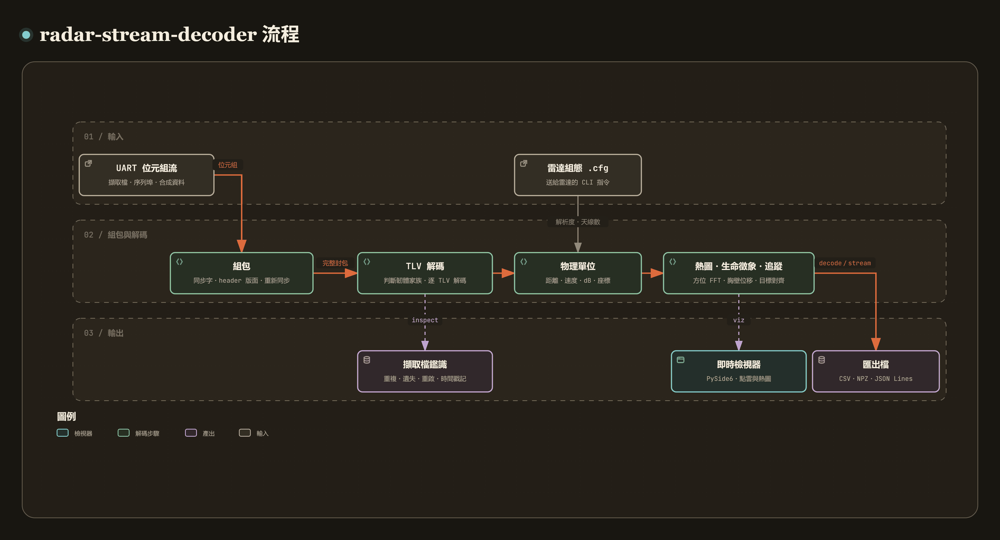

# radar-stream-decoder

[](https://github.com/recklight/radar-stream-decoder/actions/workflows/ci.yml)
[](https://www.python.org/downloads/)
[](LICENSE)

[English](README.md) | 繁體中文

TI mmWave 雷達 UART 資料流（Type-Length-Value 封包）的解碼器。

本專案（Python 套件 `radar_stream_decoder`，命令列工具 `radar-stream-decoder`）把 IWR14xx／IWR16xx／IWR18xx／IWR68xx 等 TI 毫米波雷達從資料埠送出的位元組流，轉成帶物理單位的 NumPy 資料：偵測點雲（距離、都卜勒速度、方位角、仰角、SNR）、距離剖面（range profile）、雜訊剖面、距離–都卜勒熱圖、方位熱圖、處理統計、Vital Signs 生命徵象摘要，以及 people counting／people tracking 韌體在感測器上追蹤出的目標清單、每個點所屬的目標與 presence。它可以讀離線擷取檔，也可以直接從序列埠即時串流，並附一個 PySide6 即時檢視器。

作者：RL

---

## 目錄

- [專案簡介](#專案簡介)
- [支援的韌體格式與驗證程度](#支援的韌體格式與驗證程度)
- [TI 文件與韌體不一致之處](#ti-文件與韌體不一致之處)
- [方法說明](#方法說明)
- [安裝步驟](#安裝步驟)
- [快速開始](#快速開始)
- [使用範例](#使用範例)
- [CLI 指令對照表](#cli-指令對照表)
- [圖形介面](#圖形介面)
- [專案結構](#專案結構)
- [資料準備](#資料準備)
- [設定檔](#設定檔)
- [結果與評估指標](#結果與評估指標)
- [已知限制](#已知限制)
- [設計重點](#設計重點)
- [開發與測試](#開發與測試)
- [廠商公開技術文件](#廠商公開技術文件)
- [References](#references)
- [License](#license)

---

## 專案簡介

[](https://raw.githack.com/recklight/radar-stream-decoder/master/docs/workflow.zh-TW.html?theme=dark)

互動式流程圖：[線上瀏覽](https://raw.githack.com/recklight/radar-stream-decoder/master/docs/workflow.zh-TW.html?theme=dark)，或在本機用瀏覽器開啟 [`docs/workflow.zh-TW.html`](docs/workflow.zh-TW.html)。可以縮放、搜尋節點，也能追蹤任兩個步驟之間的路徑。

TI 毫米波雷達的 out-of-box demo 與各種 lab 韌體，都把每個 frame 的處理結果包成一個封包，從資料埠送出：一個 8 位元組的同步字、一段 header，接著若干個 TLV（type、length、payload）。格式本身不複雜，麻煩在細節：

- TLV 類型編號依韌體而異。同樣是 type 1，在 out-of-box demo 是偵測點，在 Vital Signs lab 卻是複數的距離片段；type 6 在 out-of-box demo 是處理統計，在 people counting lab 卻是點雲。解碼前必須先知道（或判斷出）韌體家族。
- header 的版面不只一種。out-of-box demo 是 36 或 40 位元組，有沒有尾端的 sub-frame 欄位取決於平台與 SDK 版本，header 本身並沒有寫；3D People Counting lab 是 48 位元組、2D people counting lab 是 52 位元組，兩者欄位順序不同；和 out-of-box demo 相比，兩者都帶 checksum，TLV length 也把 type/length 的 8 位元組算進去。光看 SDK 版本字分不出來：3D People Counting lab 寫的也是 SDK 3.5 的版本字。
- 完整性檢查有限。out-of-box demo 的封包沒有 CRC，people counting lab 只有 header 的 checksum。序列埠溢位會截斷封包、接收端可能從封包中間開始讀、錄製工具可能把整個緩衝區反覆寫入檔案，完整性大多只能靠結構檢查來把關。
- 沒有雷達組態就沒有物理單位，有了組態也還有慣例之分。距離、速度、dB 刻度都要由送給雷達的 `.cfg` 推導；波長取哪個頻率、最大距離是否打八折，TI 的視覺化工具與韌體做法不同。時間戳記是會溢位回繞的 32 位元 CPU 週期計數，48 位元組的 header 則根本沒有時間戳記。

擷取檔、合成資料與序列埠走同一條程式路徑，差別只在資料來源：

| 階段 | 做什麼 | 對應模組 |
| --- | --- | --- |
| 1. 資料來源 | 擷取檔分塊讀取、合成資料、序列埠背景讀取，統一成 `ByteSource`；沒有硬體時以模擬的序列埠代替 | `sources`、`serial_link`、`port_emulator` |
| 2. 組包 | 找同步字、判斷 header 版面並驗證（含 checksum）、偵測被截斷的封包、遇錯只丟 1 位元組後重新同步 | `assembler`、`header` |
| 3. 解碼 | 決定 header 長度、依 length 切出每個 payload、判斷韌體家族（判斷不出來就回報不支援）、逐 TLV 解碼 | `header`、`schema`、`frame`、`payloads`、`tracking` |
| 4. 物理單位 | 由 `.cfg` 推導距離／速度解析度、天線數、dB 刻度（慣例可選）；點雲速度與 SNR；球座標轉直角座標 | `sensor_config`、`units`、`snr` |
| 5. 熱圖、生命徵象與追蹤 | 方位角 FFT、極座標轉直角座標；胸壁相位位移；目標清單與每點目標編號的對齊 | `angle_map`、`vital_signs`、`tracking` |
| 6. 擷取檔鑑識 | 去除重複封包、frame 遺失統計、感測器重啟、時間戳記還原、鏈路負載、追蹤統計 | `capture` |
| 7. 輸出 | CSV（點雲、目標清單）、NPZ、JSON Lines、pandas DataFrame | `export` |
| 8. 驗證 | 合成場景、錯誤注入、穩健度與估計準確度評估 | `synthetic`、`encoder`、`evaluation` |
| 9. 顯示 | PySide6 即時檢視器（運算全部在核心模組） | `presentation`、`viz` |

---

## 支援的韌體格式與驗證程度

| Schema（`--schema`） | 韌體 | 平台 | Header | TLV 類型 | 驗證程度 |
| --- | --- | --- | --- | --- | --- |
| `oob-sdk2` | out-of-box demo，SDK 1.x–2.x | xWR14xx、xWR16xx | 14xx：36 B；16xx（SDK ≥ 1.1）：40 B；無 checksum，補齊到 32 B | 1 點雲（Q-format）、2 距離剖面、3 雜訊剖面、4 方位熱圖、5 距離–都卜勒熱圖、6 統計 | **依 TI 韌體原始碼逐欄位核對**：xWR16xx 對照 TI mmWave SDK 02.00.00.04；xWR14xx 的 SDK 1.x 韌體原始碼未取得，對照 TI mmWave Demo Visualizer 2.0 的解析程式。未以實機驗證 |
| `oob-sdk3` | out-of-box demo，SDK 3.x | xWR16xx／18xx／64xx／68xx | 一律 40 B；無 checksum，補齊到 32 B | 1 點雲（float）、2–6 同上、7 每點 SNR、8 方位–仰角熱圖、9 溫度 | **依 TI 韌體原始碼逐欄位核對**：TI mmWave SDK 03.05.00.04 的 header、TLV 1–9、padding、log2 → dB 換算、時間戳記時脈。SDK 3.0–3.4、3.6 與實機擷取未驗證 |
| `vital-signs` | Vital Signs lab（mmWave Industrial Toolbox） | xWR14xx | 一律 40 B | 0 生命徵象摘要（128 B）、1 複數距離片段 | 依 TI Vital Signs lab 使用手冊的輸出格式實作；**未以實機驗證** |
| `people-counting-3d` | 3D People Counting lab，mmWave Industrial Toolbox 4.6–4.12（SDK 3.5） | xWR68xx（IWR6843 ISK／ODS／AOP） | 48 B，含 checksum、無時間戳記；TLV length 含 8 B TL；不補齊 | 6 壓縮球座標點雲、7 目標清單（112 B，或 Industrial Toolbox 4.5.1 文件的 40 B 版本）、8 每點目標編號、11 presence | **依 TI 韌體原始碼逐欄位核對**：Industrial Toolbox 4.6.0 的 `pcount3D_output.h`、`mss_main.c`（header、checksum、TLV 長度規則、點雲壓縮與單位）；目標結構依同版 TI 文件。另以 TI 解析程式做本機差分比對，結果一致。**未以實機驗證** |
| `people-counting-2d` | 2D people counting lab，mmWave Industrial Toolbox 2.x | xWR16xx（IWR1642） | 52 B，含 checksum 與 R4F 時間戳記；TLV length 含 8 B TL；不補齊 | 6 極座標點雲（每點 16 B float）、7 目標清單（68 B）、8 每點目標編號 | **依 TI 韌體原始碼逐欄位核對**：Industrial Toolbox 2.3.0 的 `mmw_output.h`、`task_mbox.c`（header、checksum、TLV 長度規則、時間戳記時脈）。**未以實機驗證** |
| `people-tracking` | Radar Toolbox 的 3D People Tracking／Overhead 3D People Tracking | xWR68xx | 與 `oob-sdk3` 相同的 40 B，補齊到 32 B | 1020 壓縮球座標點雲、1010 目標清單（112 B）、1011 每點目標編號、1012 目標高度、1021 presence | 依 TI Radar Toolbox 文件與 TI Radar Toolbox 3.20 解析程式實作（本機差分比對一致）；**未取得韌體原始碼、未以實機驗證** |

「逐欄位核對」證明的是韌體**打算送出**的版面與縮放；實際擷取的內容（padding 殘值、雜訊位準）、你手上板子跑的韌體版本，仍要靠實機資料確認，見[已知限制](#已知限制)。

**自動判別**（`--schema auto`，預設）逐封包進行，判斷依據是 header 的形狀，不是版本字：

1. offset 12 的 `uint32` 是平台代碼（`0xAxxxx`）者，只可能是 52 B 版面，且 checksum 必須吻合。
2. 否則先試 36/40 B 版面（out-of-box demo、Vital Signs、people tracking），再試 48 B 版面（checksum 必須吻合）。兩者都過關時（48 B header 的處理時間欄位很小時可能發生），以「checksum 吻合且各 TLV 長度（含 TL）加總剛好等於封包長度」者為 48 B。
3. 36/40 B 版面再依 TLV 決定韌體家族：xWR14xx、40 B header 且帶有 128 位元組 type 0 者為 `vital-signs`；SDK 1.x/2.x 為 `oob-sdk2`；SDK 3.x 在 `oob-sdk3` 與 `people-tracking` 之間選「認得最多 TLV 類型」者。
4. 判斷不出來就不硬套：TLV 類型沒有任何候選格式認得的封包，以 `unsupported-format` issue 回報並捨棄（`decode_packet` 拋出 `UnsupportedFormatError`），`inspect` 報告會列出次數。確知韌體時可以用 `--schema` 強制指定；指定的 schema 同時決定 header 版面。

其他已知的格式細節：

- SDK 1.0 韌體的都卜勒索引是無號 FFT bin，SDK 1.1 起為有號；解碼器依 header 版本自動處理。
- header 的 `numDetectedObj` 不可信（Vital Signs 韌體固定寫 99），點數一律以 payload 為準。
- padding 的內容：SDK 2.0 的 xWR16xx 以固定值填充（debug 版本為 `0x0F`），因此 padding 混入其他位元組代表封包被截斷後接上了別的資料；**SDK 3.x 的韌體從未初始化 padding**（送出的是堆疊上的殘值），所以 `oob-sdk3` 與 `people-tracking`（其韌體原始碼未取得，比照 SDK 3.x 處理）不以 padding 內容判錯，只記一筆 `uneven-padding` 資訊，截斷與否只看長度與下一個同步字。
- header 時間戳記：xWR14xx 與 SDK 3.x（各平台）為 R4F 200 MHz；xWR16xx 的 SDK 1.x/2.x 由 DSP 蓋時間戳記，為 600 MHz；2D people counting lab 為 R4F 200 MHz（`task_mbox.c` 在 R4F 上以 `Cycleprofiler_getTimeStamp()` 取值）；48 B 的 3D People Counting header 沒有時間戳記，只能用 frame 編號乘以 `.cfg` 的 frame 週期計時。時脈可在 `DecoderConfig.clock_hz` 覆寫。
- people counting／tracking 的「每點目標編號」描述的是**上一個 frame** 的點雲（TI 文件的定義：第 *i* 個值是上一個 frame 第 *i* 個點所屬的目標）；253、254、255 分別代表 SNR 太弱、在邊界外、視為雜訊而未歸屬任何目標。解碼器會把它掛回上一個 frame 的點上，見[方法說明](#方法說明)第 9 節。

格式規格的來源列在[廠商公開技術文件](#廠商公開技術文件)。

---

## TI 文件與韌體不一致之處

TI 的公開文件與 TI mmWave SDK 03.05.00.04 的韌體原始碼至少有以下 5 處不一致。**本套件一律以韌體為準**，理由很單純：解碼器面對的是韌體實際送出的位元組，文件只是對它的描述；當描述與產生位元組的程式不符，只有程式是對的。測試如果拿自己的編碼器產生封包，編碼器和解碼器照同一份文件寫，文件錯的地方兩邊會一起錯，測試照樣通過；所以這幾處的參考封包另以 `struct.pack` 照 C 結構打包、期望值以 NumPy 照韌體演算法算出（`tests/test_firmware_reference.py`、`tests/test_people_counting.py`），不經過自己的編碼器。

| 項目 | TI 文件的說法 | SDK 3.5 韌體原始碼 | 若照文件會怎樣 |
| --- | --- | --- | --- |
| 距離剖面、雜訊剖面、距離–都卜勒熱圖的格式 | 各接收天線 log2 幅度之和，Q9 | **Q8**，每根虛擬天線先右移 ⌈log₂ N⌉ 再累加（`dopplerprocdsp.c` 的 `DPU_DopplerProcDSP_log2AbsAccum`、`mmwavelib_accum16shift`；`dpif_detmatrix.h`：`DPIF_DETMATRIX_DATA_QFORMAT 8`） | dB 值偏小 8 到 32 倍（3TX4RX 為 32 倍） |
| TLV 7 每點 SNR 與雜訊的型別 | `uint16` | **`int16`**（`dpif_pointcloud.h` 的 `DPIF_PointCloudSideInfo`） | 負值變成約 6552 dB |
| TLV 9 溫度報告 | 有效旗標 `uint32`、溫度 `uint16` | **`int32` 狀態（0 代表有效）**、**`int16` 溫度**（`mmw_mss.h` 的 `MmwDemo_temperatureStats`、`rl_sensor.h` 的 `rlRfTempData_t`） | 錯誤碼與零下溫度解錯 |
| `guiMonitor` 的 `<detected objects>` 取哪個值才送 TLV 7 | 「set to 2」 | **1** = 點雲加 side info，2 = 只有點雲（`mmw_config.h`；SDK 3.06 User Guide 也是如此） | 對 TLV 7 是否存在的預期相反 |
| header 長度 | Industrial Toolbox 4.10 的 out-of-box UART 頁寫 44 B | **40 B**（`mmw_output.h` 的 `MmwDemo_output_message_header` 欄位加總；`mss_main.c` 以 `sizeof` 起算封包長度） | 每個 TLV 錯位 4 位元組 |

這 5 處都已寫進對應程式碼的註解（`units.py`、`payloads.py`、`sensor_config.py`、`constants.py`），並標明以 SDK 3.5 韌體為準。

people counting 系列另有幾處文件與程式彼此矛盾，處理方式如下：

- Industrial Toolbox 4.6 的 3D People Counting 文件寫「每個目標 40 bytes」，但列出的是 112 B 的結構（`tid`、位置／速度／加速度 XYZ、`ec[16]`、`g`、`confidenceLevel`）；4.5.1 的文件則真的是 40 B。韌體以 `sizeof(trackerProc_Target)` 決定長度，所以本套件兩種都支援，依 TLV 長度與「每個目標編號都落在 0–249」判斷；長度同時是 112 與 40 的倍數且兩種讀法都合理時取 112 B，並記一筆 `ambiguous-record-size` 資訊。
- TI 的 MATLAB 程式與文件把 2D people counting header 的時間戳記註明為「600MHz free running clocks」，但韌體在 R4F 上蓋時間戳記（`task_mbox.c`），R4F 的時脈是 200 MHz。本套件用 200 MHz。
- Industrial Toolbox 4.5.1 的 Python 解析程式把 header 最後兩個時間欄位的順序寫反；本套件依韌體結構的順序（追蹤時間、UART 傳送時間）。
- Radar Toolbox 文件把 TLV 1012（目標高度）的長度寫成「點數 × 12」，TI 自己的解析程式是「目標數 × 12」；本套件依後者，並以目標編號把高度對回目標清單。

---

## 方法說明

### 1. 封包結構

```
padded 版面（out-of-box demo、Vital Signs、people tracking）
  0        8        12       16        20       24       28       32       36       40
  +--------+--------+--------+---------+--------+--------+--------+--------+---------+
  | 同步字 | version| 封包長度| platform| frame  | CPU    | 點數   | TLV 數 |sub-frame|  ← 36 或 40 B
  +--------+--------+--------+---------+--------+--------+--------+--------+---------+
  | type | length | payload（length 位元組） | type | length | payload | ... | padding（< 32 B） |

checksummed 48 B 版面（3D People Counting）
  同步字 | version | 封包長度 | platform | frame | sub-frame | chirp 餘裕 | frame 處理時間 |
  追蹤時間 | UART 時間 | TLV 數 (u16) | checksum (u16) ┃ type | length（含 8 B）| payload | ...

checksummed 52 B 版面（2D people counting）
  同步字 | version | platform | CPU 週期 | 封包長度 | frame | sub-frame | chirp 餘裕 |
  frame 餘裕 | 追蹤時間 | UART 時間 | TLV 數 (u16) | checksum (u16) ┃ TLV ...
```

同步字為 `02 01 04 03 06 05 08 07`（小端序 uint16 `0x0102 0x0304 0x0506 0x0708`）；所有欄位皆為小端序；`version = major<<24 | minor<<16 | bugfix<<8 | build`。padded 版面的封包長度包含 header 與 padding，為 32 的倍數，TLV length 不含 type/length 這 8 位元組；checksummed 版面不補齊，封包長度就是 header 加上各 TLV，TLV length 包含那 8 位元組。checksum 是韌體以 checksum 欄位為 0 時，把 header 的 `uint16` 全部相加後算出的 `~((sum >> 16) + (sum & 0xFFFF))`（取低 16 位元）；解碼器用同一個算式重算並比對，`header.header_checksum()` 可直接呼叫。

### 2. padded 版面的 36 或 40 位元組 header

header 是否帶 sub-frame 欄位，由 `constants.HEADER_RULES` 規則表決定（依序比對，第一條符合者生效）：

| 條件 | header |
| --- | --- |
| schema 為 `vital-signs` | 40 |
| schema 為 `oob-sdk3` 或 `people-tracking`，或 SDK 主版本 ≥ 3 | 40 |
| xWR16xx 且 SDK ≥ 1.1 | 40 |
| xWR16xx 且 SDK < 1.1 | 36 |
| xWR14xx 且 schema 為 `oob-sdk2` | 36 |
| 其他（例如 xWR14xx 而 schema 尚未確定） | 由資料推斷 |

推斷的方法：分別假設 36 與 40，沿 TLV 鏈走一遍，保留「鏈不超出宣告的封包長度、每個 TLV 的類型與長度都合乎某個 padded 版面的 schema、剩餘 padding 少於 32 位元組」的那一種。規則與資料衝突時（例如 xWR16xx SDK 2.0 的封包卻沒有 sub-frame 欄位），以能讓 TLV 鏈吻合的長度為準，並在 frame 上記一筆 `header-length-conflict` 警告。

### 3. 可重新同步的組包器

`FrameAssembler.feed()` 可以任意切塊餵入（整個檔案一次、或一次 1 個位元組），輸出完全相同。內部是一個小型狀態機：

1. 找同步字。同步字之前的位元組略過，緩衝區尾端保留 7 個位元組以免同步字跨越兩次讀取。
2. 判斷並驗證 header：依[支援的韌體格式](#支援的韌體格式與驗證程度)的判別規則決定版面（需要 36、48 或 52 個位元組），再檢查 SDK 主版本 1–3、`platform >> 16 == 0xA`、TLV 數 ≤ 32、封包長度足以容納 header 與每個 TLV 的 8 位元組、且不超過上限（預設 262144）；checksummed 版面另外要求 checksum 吻合；strict 模式下 padded 版面要求長度為 32 的倍數。驗證失敗**只丟 1 個位元組**，從下一個位置繼續找同步字；checksum 不符的以 `checksum-mismatch` 記錄。
3. 偵測截斷：等待封包補齊時，若宣告範圍內出現另一個同步字，且其後是合理的 header，代表目前封包在傳輸中被截斷。lenient 模式會解出截斷點之前完整的 TLV（frame 標記 `truncated`），strict 模式則捨棄；兩者都從內部同步字繼續，**下一個封包不會被連帶犧牲**。宣告的長度已收齊、但最後幾個位元組可能是下一個同步字的開頭時，會先多等最多 7 個位元組（或資料流結束）再判斷，所以即使同步字跨越宣告的結尾，結果也與切塊方式無關。
4. 解碼完整封包。完全無法解碼（沒有任何 TLV 成功）的候選封包同樣只丟 1 個位元組後重新同步；結構完好但不屬於任何已知韌體的封包以 `unsupported-format` 記錄後捨棄。

資料流結束時 `finish()` 會解出仍可解的部分，未完成的尾段（包括停在 header 中間的封包）只記為 `truncated_tail_bytes`，不拋出例外。

完整性靠以下結構檢查：同步字、header 合理性與 checksum、TLV 鏈與封包長度吻合（checksummed 版面要求剛好用完，padded 版面要求剩下的 padding 少於 32 位元組）、已知類型、每個 payload 的長度一致性（例如 SDK 2.x 點雲必須正好 `4 + 12N` 位元組），以及 SDK 2.x 與 Vital Signs 的 padding 必須是**同一個重複值**。

### 4. TLV 解碼與資料模型

每個 decoder 只拿到該 TLV length 所涵蓋的 `memoryview` 切片，絕不讀到相鄰資料。長度與內容不符時，解出切片內能解的部分並記錄 `DecodeIssue`。

| 類型 | 格式 | 資料模型 |
| --- | --- | --- |
| 點雲（SDK 2.x） | `uint16 N, uint16 Q` + N ×（`uint16 rangeIdx, int16 dopplerIdx, uint16 peak, int16 x, y, z`），座標（公尺）= 值 / 2^Q | `PointCloud` |
| 點雲（SDK 3.x） | N ×（`float32 x, y, z, velocity`）；side info N ×（`int16 snr, noise`，0.1 dB） | `PointCloud` + `PointSideInfo` |
| 距離剖面／雜訊剖面 | 每個距離 bin 一個 `uint16` log2 幅度（分別取都卜勒 bin 0 與 D/2−1） | `MagnitudeProfile` |
| 距離–都卜勒熱圖 | R × D 個 `uint16`，以距離為主序 | `RangeDopplerMap` |
| 方位熱圖 | R × A 個 `{int16 虛部, int16 實部}`（虛部在前） | `AzimuthHeatmap` |
| 統計 | 6 × `uint32`（處理時間、傳輸時間、餘裕 µs、CPU 負載 %） | `ProcessingStats` |
| 溫度（SDK 3.x） | `int32 狀態, uint32 時間` + 10 × `int16` °C | `TemperatureReport` |
| 生命徵象摘要 | 128 位元組結構（20 個估計值 + 8 個保留欄位） | `VitalSignsSummary` |
| 距離片段 | (end − start + 1) × `{int16 實部, int16 虛部}`（實部在前） | `RangeSegment` |
| 壓縮球座標點雲（3D lab TLV 6、people tracking TLV 1020） | 5 × `float32` 單位（仰角、方位角、都卜勒、距離、SNR）+ N ×（`int8 仰角, int8 方位角, int16 都卜勒, uint16 距離, uint16 SNR`），值乘以單位 | `PointCloud`（`snr_linear`） |
| 極座標點雲（2D lab TLV 6） | N ×（`float32 距離, 方位角, 都卜勒, SNR`） | `PointCloud`（`z = 0`） |
| 目標清單 | 3D：112 B（`uint32 tid`、`float32` 位置／速度／加速度 XYZ、`ec[16]`、`g`、`confidence`）或 Industrial Toolbox 4.5.1 文件的 40 B 版本；2D：68 B（`tid`、位置／速度／加速度 XY、`ec[9]`、`g`） | `TargetList` |
| 每點目標編號 | N × `uint8`，描述上一個 frame 的點 | `TargetAssociation` → `PointCloud.target_id` |
| 目標高度（TLV 1012） | 每目標 `uint32 tid, float32 maxZ, minZ` | `TargetHeights`（併入 `TargetList`） |
| presence（TLV 11、1021） | `uint32`，非 0 代表有人 | `PresenceIndication` |

`RadarFrame` 收齊同一封包的所有 payload，再做跨 TLV 的補充：點雲速度、SNR、log2 → dB 刻度、距離片段的起始 bin、目標高度。距離–都卜勒熱圖的形狀依序由雷達組態、同一封包的距離剖面長度、`DecoderConfig.num_range_bins` 推得；都沒有時保留一維資料並記錄問題。

### 5. 由 `.cfg` 推導 FMCW 參數與慣例選項

`parse_cli_config()` 解析 `profileCfg`、`channelCfg`、`chirpCfg`、`frameCfg`、`guiMonitor`（xWR14xx 6 個參數、其他平台 7 個）、`dfeDataOutputMode`、`compRangeBiasAndRxChanPhase`；其他指令（包括 people counting 的追蹤參數）原樣保存。參數個數或數值錯誤時拋出帶行號的 `ConfigError`。以 $c = 3\times10^8$ m/s（與 TI 工具一致）、斜率 $S$、取樣率 $F_s$、ADC 取樣點數 $N$、距離 FFT 長度 $N_R = 2^{\lceil\log_2 N\rceil}$、chirp 週期 $T_c = T_{idle} + T_{ramp}$、frame 內的發射天線數 $N_{tx}$、每支發射天線的 chirp 數 $N_c$、都卜勒 FFT 長度 $N_D = 2^{\lceil \log_2 N_c \rceil}$、參考頻率 $f_{ref}$：

$$
\Delta R = \frac{c F_s}{2 S N}, \qquad
\Delta R_{\text{bin}} = \frac{c F_s}{2 S N_R}, \qquad
R_{\max} = k\,\frac{c F_s}{2 S}
$$

$$
\Delta v_{\text{bin}} = \frac{c}{2 f_{ref} T_c N_{tx} N_D}, \qquad
v_{\max} = \frac{c}{4 f_{ref} T_c N_{tx}}
$$

其中三項取決於**慣例**而非物理本身，各家工具做法不同，本套件把它們做成選項（`FmcwConvention`，CLI 為 `sensor-config` 的三個參數），並在輸出中以 `convention_*` 欄位標明使用的慣例：

| 選項 | 可選值 | 意義 |
| --- | --- | --- |
| `--wavelength-at` | `start`（預設）／`center` | 速度換算用的波長：chirp 起始頻率 $f_0$（TI mmWave Demo Visualizer），或 SDK 3.5 韌體 `mmwdemo_rfparser.c` 的 `centerFreq` $= f_0 + B/2 + T_{adc} S$（$B = SN/F_s$） |
| `--max-range-factor` | `0.8`（預設）～`1` | $R_{\max}$ 取 IF 頻寬極限 $cF_s/(2S)$ 的幾成；TI 視覺化工具保留 0.8 給 IF 濾波器滾降 |
| `--doppler-padding/--no-doppler-padding` | 補零（預設）／不補零 | 速度解析度要報補零後的 FFT bin 間距（韌體的 `dopplerStep`），還是實際發射的 chirp 數決定的 $c/(2 f_{ref} T_c N_{chirps})$（韌體的 `dopplerResolution`） |

都卜勒 bin 索引一律以 bin 間距 `doppler_bin_mps` 換算成速度，不受補零選項影響（韌體的 FFT 就是 $N_D$ 點）；波長選項則同時影響 bin 間距、$v_{\max}$ 與 Vital Signs 的相位–位移換算。

**預設採 TI mmWave Demo Visualizer 的慣例（起始頻率、0.8、補零）**：那是 TI 自家視覺化工具顯示的數字，使用者最常拿來對照；SDK 1.x/2.x 的點雲速度本來就由主機端以起始頻率換算。之後的版本也會維持這個預設，同一份 `.cfg` 不會因為升級而算出不同的數字。要和 **SDK 3.x 韌體自己算出的點雲速度**一致（例如畫 SDK 3.x 距離–都卜勒熱圖的速度軸），請用 `--wavelength-at center`。以 TI mmWave Industrial Toolbox 4.6.0 的 `ODS_6m_default.cfg`（60.75 GHz、斜率 54.71 MHz/µs、96 個取樣、3 發 4 收、288 chirps）為例：距離解析度兩種慣例都是 0.08425 m；$v_{\max}$ 以起始頻率算是 4.619 m/s，以 centerFreq（63.008 GHz）算是 4.453 m/s，差 3.6%；$R_{\max}$ 乘 0.8 為 6.470 m、不乘為 8.088 m。`decode`、`inspect`、`stream`、`viz` 使用預設慣例；Python API 可用 `load_cli_config(path, platform, FmcwConvention(...))` 或 `SensorConfig.with_convention()` 換成其他慣例。

天線數：$N_{rx}$ 為 `rxMask` 的位元數；$N_{tx}$ 取自 frame 內各 chirp 實際使用的發射天線。方位陣列在 xWR16xx 為 TX0、TX1，在三發射天線的平台為 TX0、TX2（TX1 用於仰角）；frame 只用一支發射天線時，它就是方位陣列。平台取自 `--platform`；解碼時沒有指定，就用封包 header 的平台代碼。點座標的 Q-format 為 $\lceil \log_2(16/\Delta R_{\text{bin}})\rceil$。FMCW 的基本原理見 Stove（1992）與 Richards（2014），TDM-MIMO 虛擬陣列見 Li & Stoica（2007）。

### 6. log2 幅度轉 dB

剖面與熱圖是定點格式的 log2 幅度，三種韌體把各虛擬天線的值合併的方式不同（`units.Log2Combining`）。設 $v$ 為原始值、$f$ 為小數位元數、$N = N_{rx}N_{tx}$ 為全部虛擬天線數（含仰角發射天線），每根天線的平均位準為：

| 韌體 | 合併方式 | 每根天線的平均位準（dB） |
| --- | --- | --- |
| xWR14xx，SDK 1.x | 平均，Q9 | $v \cdot 20\log_{10}2 / 2^{9}$（啟用仰角發射天線時另乘 4/3，TI 視覺化工具同樣如此處理） |
| xWR16xx，SDK 1.x/2.x | 直接相加，Q8 | $v \cdot 20\log_{10}2 / (2^{8} N)$ |
| SDK 3.x（各平台） | 每根天線先右移 $\lceil\log_2 N\rceil$ 再相加，Q8 | $v \cdot 20\log_{10}2 \cdot 2^{\lceil\log_2 N\rceil} / (2^{8} N)$ |

SDK 3.x 的演算法取自 TI mmWave SDK 03.05.00.04 的 `DPU_DopplerProcDSP_log2AbsAccum`：第一根天線的 Q8 log2 幅度右移 $\lceil\log_2 N\rceil$ 位作為起始值，其餘以 `mmwavelib_accum16shift`（`out += in >> shift`）累加。TI 自己在 `mss_main.c` 換算 CFAR 門檻時用的也是同一個比例（`dB * (256/6) * (N / 2^ceil(log2 N))`）。例：3 發 4 收（$N = 12$）、每根天線 log2 幅度為 15 時，韌體寫出 $12 \times (3840 \gg 4) = 2880$，對應 $15 \times 6.02 = 90.31$ dB；照 TI 文件的「Q9 加總」會算成 2.82 dB。右移造成的截斷誤差每根天線小於 $2^{\lceil\log_2 N\rceil}$ 個 Q8 LSB（$N = 12$ 時約 0.38 dB）。本套件以 $20\log_{10}2 \approx 6.02$ dB 為一個 log2 單位，TI 的門檻換算用 6 dB，兩者差 0.34%。

`units.fft_scale_compensation_db()` 另提供 TI 視覺化工具使用的絕對位準補償（xWR14xx 為 $20\log_{10}(32/R)$），預設不套用，因為 SNR 等相對量不需要它。`DecoderConfig` 的 `log2_fraction_bits`、`log2_combining`、`db_per_lsb` 可覆寫上述規則。

### 7. 每點 SNR

SDK 2.x 不送每點 SNR，而 xWR16xx 的 `peakVal` 是線性振幅，不能直接和 log2 剖面相減。解碼器以同一 frame 的 log2 陣列估計：

- 有距離–都卜勒熱圖時：取點所在格 $M[r, d]$，雜訊為同一距離 bin 沿都卜勒軸、略過 guard cell 的訓練格平均（都卜勒軸為循環），可選 cell-averaging（CA，Finn & Johnson 1968）或兩側取小（SO，Trunk 1978）；$\text{SNR} = (M[r,d] - \hat{N})\cdot \text{dB/LSB}$。都卜勒軸太短、放不下 guard cell 與訓練格時（例如只有 4 個 bin、每側 2 個 guard cell），該 frame 的點不估 SNR，記一筆 `invalid-value` 警告，其餘照常解碼。
- 只有剖面時：以距離剖面減雜訊剖面近似（靜止點正確，移動點為近似），記為 `noise_profile`。
- SDK 3.x：直接使用 side info。
- people counting／tracking：韌體送的是 TI 稱為線性比值的 SNR，原樣保存在 `snr_linear`，不換算成 dB（檢視器以 $10\log_{10}$ 顯示強弱）。

對數域平均會低估雜訊功率：在 Rayleigh 雜訊下，指數分布功率取 $10\log_{10}$ 後的平均比平均功率的 dB 值低 $10\gamma/\ln 10 \approx 2.51$ dB（$\gamma$ 為 Euler–Mascheroni 常數），因此 SNR 會高估約 2.5 dB。設定 `snr_log_bias_correction = true` 可扣除此偏差（實測結果見[結果與評估指標](#結果與評估指標)）。

### 8. 方位熱圖

type 4 是零都卜勒的雷達立方體切片。陣元間距 λ/2 時，方位角 $\theta$ 的目標在相鄰虛擬天線間造成 $\pi\sin\theta$ 的相位差，對虛擬天線做 $N$ 點補零 FFT（FFT／Bartlett 波束成形，Krim & Viberg 1996）並 `fftshift` 後，bin $k$ 對應

$$
\theta_k = \arcsin(2k/N), \qquad k = -N/2+1, \dots, N/2-1 .
$$

若把每對 int16 誤當成實部在前，得到的是 $j\,\overline{z}$，角度譜左右鏡像；解碼器依格式以虛部在前解碼，不需要再翻轉。峰值角度以對數幅度的拋物線內插求次 bin 精度；`polar_to_cartesian()` 以純 NumPy 的雙線性內插把 $(r,\theta)$ 熱圖重取樣到 $x = r\sin\theta,\ y = r\cos\theta$ 的直角格點（角度軸不等間距也可）。

### 9. people counting／tracking：點雲、目標與每點目標編號

點雲以球座標送出，解碼時用與其他格式相同的 `units.spherical_to_cartesian` 轉成直角座標：$x = R\cos\phi\sin\theta$、$y = R\cos\phi\cos\theta$、$z = R\sin\phi$（$\theta$ 方位角、$\phi$ 仰角），與 TI 視覺化工具相同；2D lab 沒有仰角，$z = 0$。感測器裝在天花板往下照時，$y$ 軸指向地板（TI Overhead 使用手冊的說法）。壓縮點雲的單位寫在 TLV 開頭，3D lab 的韌體用 0.01 rad、0.01 rad、0.00028 m/s、0.00025 m 與 0.04。

目標清單直接來自感測器上的追蹤器，每個目標有編號（0–249）、位置、速度、加速度，3D 版另有 4×4 誤差共變異數、閘控增益與信心值。每點目標編號 TLV 在第 $n$ 個 frame 送出、描述的卻是**第 $n-1$ 個 frame** 的點：韌體是在送出第 $n-1$ 個 frame 之後才對那批點做追蹤（2D lab 的 `task_mbox.c` 以雙緩衝送出上一次的追蹤結果；3D lab 的 `mss_main.c` 中 UART 傳送 task 的優先權高於追蹤 task，第 $n$ 個 frame 的封包先送出，追蹤器之後才處理這批點）。`tracking.link_target_associations()` 依 frame 編號把它掛回上一個 frame 的 `PointCloud.target_id`：上一個 frame 遺失時記為 orphaned，點數對不上時記一筆 `association-mismatch` 警告而不掛（目標高度 TLV 指到目標清單沒有的編號時，也記同一個 code）。`analyze_capture()`、`write_points_csv()` 與即時寫檔的 `PointCsvWriter`（會延後一 frame寫出）都會自動做這一步，所以點雲 CSV 的 `target_id` 欄就是每個點所屬的目標。

### 10. 擷取檔鑑識

- 去除重複：與最近 64 個 frame 中任一個的（frame 編號、sub-frame 編號、CRC-32）完全相同者視為重複並捨棄。frame 編號相同但內容不同時，若它緊接在第一份之後、header 時間戳記與第一份相同，或本身受損（被截斷或有錯誤層級問題），就記為衝突，只保留第一份：整塊寫入的錄製器重寫同一個封包時，時間戳記也一起重寫。其餘 frame 編號倒退的情況記為感測器重啟，重啟後計數器從頭開始，時間戳記與先前無關。例外是先收到的副本受損、後來的副本完好：此時保留完好的副本、捨棄受損的副本，並計入 `replaced_copies`；整塊寫入的錄製器可能在某次寫入的結尾截斷封包，下一次寫入時再完整寫一次。
- frame 遺失：統計相鄰 frame 編號差的直方圖、遺失 frame 數與遺失率 $\text{missing}/(\text{unique}+\text{missing})$。
- 時間戳記：header 的 CPU 週期計數為 32 位元（200 MHz 每 21.5 秒回繞、600 MHz 每 7.2 秒回繞）。先由小間隔（≤ 4 個 frame）的週期差中位數估計 frame 週期 $T$，再對每一步選擇回繞次數 $m$，使 $\Delta c + m\,2^{32}$ 最接近 $\Delta n \cdot T \cdot f_{clk}$，因此即使相鄰收到的 frame 間隔超過一次回繞週期也能正確還原。48 B header 沒有時間戳記，只能用 frame 編號乘以 `.cfg` 的 frame 週期（或 `nominal_frame_period_s`）計時，報告會註明。
- 鏈路負載：平均封包長度除以 frame 週期，再除以 921600 baud 資料埠每秒可傳的 92160 位元組。超過 100% 表示韌體根本無法每個 frame 都送出（例如 20 fps 同時開啟全部熱圖），這本身就是 frame 遺失的原因。
- 追蹤統計：帶目標清單的 frame 數、每個 frame 目標數的平均與最大值、回報有人的 frame 數，以及每點目標編號的對齊結果（linked／mismatched／orphaned）。header checksum 不符的次數列在 issue 統計的 `checksum-mismatch`。

### 11. Vital Signs：胸壁位移

胸壁位移 $d$ 使來回路徑改變 $2d$，故

$$
d = \frac{\lambda}{4\pi}\,\mathrm{unwrap}(\angle X_k) .
$$

相位展開假設相鄰樣本間的相位變化小於 π（Itoh 1982）；frame 有缺口時這個假設不成立，因此 `phase_displacement_mm()` 對每一段連續 frame 分別展開，不跨越缺口。以 FMCW 雷達追蹤生命徵象的方法見 Wang et al.（2014）。Vital Signs 韌體的距離片段複製迴圈少寫最後一個 bin（該 bin 恆為 0），`RangeSegment.last_bin_written` 會如實反映，不把它當成資料。

### 12. 合成資料與錯誤注入

`synthetic` 依 FMCW 模型產生位元組完全合法的封包：目標直線移動或來回擺動，距離與徑向速度依雷達組態量化成 bin；距離–都卜勒熱圖為 Rayleigh 雜訊加上各目標的 3 × 3 擴散，距離剖面與雜訊剖面就是它的零都卜勒欄與最高都卜勒欄（與韌體取法相同）；方位熱圖為複數高斯雜訊加上靜止目標的 TDM-MIMO steering vector $e^{j\pi n\sin\theta}$；點雲是 SNR 超過門檻的目標。Vital Signs 場景則在一個距離 bin 放入呼吸加心跳的胸壁運動，產生與 lab 韌體同構的 288 位元組封包（header 40 B、點數固定 99、片段 bin 8–29）。people counting／tracking 場景在每個看得到的目標周圍散布數個球座標點、加入少量雜訊點，以真實狀態回報目標清單，並在下一 frame送出這些點的目標編號，與感測器上的追蹤器相同。

`inject_faults()` 依 `FaultPlan` 注入前置與穿插的雜訊位元組、帶有合理 header 的偽造同步字、掉封包、封包截斷、位元翻轉、重複封包，以及「每次把整個工作緩衝區寫入檔案」的錄製缺陷，並記錄每個封包的遭遇，供評估使用。所有亂數都來自 `numpy.random.default_rng(seed)`，同一個 seed 產生逐位元組相同的資料流。

### 13. 序列埠：交握、韌體行為與模擬器

TI 評估板有兩個序列埠：CLI 埠（115200 baud）收 `.cfg` 文字指令，資料埠（預設 921600 baud，8N1、無流量控制）送二進位的 TLV 資料流。`send_cli_config()` 的交握依 TI mmWave SDK 03.05.00.04 的 CLI 原始碼（`cli.c`、`uartsci.c`、`mmw_cli.c`）寫成：

- 送 `.cfg` 前先清空 CLI 埠的輸入緩衝區，以免開機 banner 或上一次留下的 `Done` 被當成回應。
- 每行指令補 `\n` 送出（送 CRLF 會讓韌體多執行一次空指令）。韌體逐位元組回顯，可能先印出 `Ignored: …`、`Debug: …`、`Error: …` 之類的訊息行，再回 `Done` 或 `Error <錯誤碼>`。提示字元 `mmwDemo:/>` 後面沒有換行，會黏在下一行回顯的前面；韌體輸出時每個 LF 後面補一個 CR（`Done\n\r`）。交握會把讀到一半的行接起來、去掉提示字元與回顯。
- 收到 `Error <碼>` 立刻以 `SensorCommandError` 回報錯誤並指出行號與錯誤碼；不認得的指令韌體只回 `'<指令>' is not recognized as a CLI command`、沒有 `Done` 也沒有 `Error`，交握也立刻回報錯誤，不會等到逾時；完全沒有回應時才在逾時（預設 2 秒）後報「did not acknowledge」。
- `configDataPort <baud> <ackPing>`：韌體在停止狀態下會把資料埠改成新的 baud（最高 3125000），`ackPing` 為 1 時再從資料埠送出 16 個 `0xFF`。本套件選擇**跟著換**：這行指令得到 `Done` 且回應中沒有 `Ignored` 時，主機端的資料埠也改成同一個 baud（`SerialByteSource` 會把開著的資料埠交給交握）；那 16 個 `0xFF` 在組包時當成同步字之前的雜訊略過。單獨呼叫 `send_cli_config()` 而沒有提供資料埠時，會記錄一筆警告提醒要自行以新 baud 開埠。
- `stream` 遇到序列埠開不了（pyserial 的 `SerialException` 是 `OSError`）、感測器拒絕或不回應指令、資料埠讀取失敗時，只印一行訊息（感測器的多行回應會以分號接成同一行）並以結束碼 2 結束，traceback 只在 `--log-level DEBUG` 時記錄；`viz` 的序列埠在背景執行緒讀取，同樣的錯誤以一行訊息顯示在視窗中，不會關閉視窗。`--record` 的檔案寫不進去時同樣以資料埠讀取失敗回報；它所在的資料夾不存在時會自動建立。

沒有硬體時，用 `port_emulator` 裡的模擬序列埠代替，它們也是照同一批原始碼寫的。`EmulatedCliPort` 模擬 CLI 埠（開機 banner `xWR68xx MMW Demo 03.05.00.04`、不換行的提示字元、回顯時 LF 不補 CR 而 CR 回顯成 CRLF、輸出 LF 後補 CR、`%` 開頭的行回 `Skipped`、未知指令只回 not recognized、已停止時 `sensorStop` 回 `Ignored: Sensor is already stopped`、第一次 `sensorStart` 前缺少必要指令時回 `Error: Full configuration must be provided …` 加 `Error -1`、第一次啟動時印出 `Debug: Init Calibration Status = 0x1ffe`、`queryDemoStatus`、`configDataPort` 的換 baud 與 16 個 `0xFF`）；`EmulatedDataPort` 依序送出資料，可依線路速率限速，`sensorStart` 之後才開始送，兩端 baud 不一致時讀到的是全 0（代替真實 UART 的 framing error）。`EmulatedPortFactory` 可直接當 `serial_factory` 使用，測試、`examples/live_serial_capture.py --dry-run` 與檢視器的序列埠測試都透過它跑完真正的交握與背景讀取程式。模擬器只檢查韌體啟動前必要指令的一個子集（`channelCfg`、`profileCfg`、`chirpCfg`、`frameCfg`，可調），banner 內容與校正狀態值為依原始碼格式設定的假設值；它驗證的是「在依韌體原始碼推得的行為下，交握與錯誤處理是對的」，代替不了實機（見[已知限制](#已知限制)）。

---

## 安裝步驟

需要 Python 3.10 以上。

```bash
git clone https://github.com/recklight/radar-stream-decoder.git
cd radar-stream-decoder
python -m venv .venv
# Windows: .venv\Scripts\activate    Linux/macOS: source .venv/bin/activate
pip install -e .                 # 核心：只依賴 numpy 與 typer
pip install -e ".[gui]"          # 圖形介面：PySide6、matplotlib
pip install -e ".[serial]"       # 即時擷取：pyserial
pip install -e ".[pandas]"       # DataFrame 匯出
pip install -e ".[all,dev]"      # 全部，加上 pytest 與 ruff
```

沒有安裝任何選用套件時，CLI 與 Python API 仍可完整使用（GUI、序列埠與 DataFrame 功能會在用到時提示要安裝哪個 extra）。也可以不安裝，直接在專案資料夾內以 `PYTHONPATH=src python -m radar_stream_decoder ...` 執行。

---

## 快速開始

沒有雷達硬體也能走完整個流程。下面的範例把擷取檔放在 `captures/`、輸出放在 `outputs/`，兩個資料夾都已列入 `.gitignore`：

```bash
# 1. 產生一份受損的合成擷取檔（同時寫出 captures/demo.cfg）
radar-stream-decoder synth captures/demo.bin --frames 300 --faults heavy

# 2. 鑑識報告：重複、frame 遺失、重新同步、frame 週期、鏈路負載
radar-stream-decoder inspect captures/demo.bin --sensor-config captures/demo.cfg

# 3. 解碼並匯出 CSV／NPZ／JSONL
radar-stream-decoder decode captures/demo.bin --sensor-config captures/demo.cfg --out outputs/decoded/

# 4. 開啟檢視器的合成示範
radar-stream-decoder viz --source demo
```

people counting 格式也一樣，解碼時另外寫出目標清單 `targets.csv`：

```bash
radar-stream-decoder synth captures/pc3d.bin --schema people-counting-3d --frames 300 --faults heavy
radar-stream-decoder decode captures/pc3d.bin --sensor-config captures/pc3d.cfg --out outputs/decoded_pc3d/
radar-stream-decoder viz --source demo --schema people-counting-3d
```

---

## 使用範例

### CLI

```bash
# 解碼一份 Vital Signs 擷取檔；--strict 會捨棄任何結構有誤的封包
radar-stream-decoder decode captures/session.bin --schema vital-signs --strict -o outputs/vital/

# 只看雷達組態推導出的參數（距離解析度、最大速度、天線數……）
radar-stream-decoder sensor-config configs/iwr1642_oob_2tx4rx.cfg --platform 16xx

# SDK 3.5 韌體的慣例：速度用 centerFreq、最大距離不打折、解析度不計補零
radar-stream-decoder sensor-config configs/iwr6843_3d_3tx4rx.cfg --platform 68xx \
    --wavelength-at center --max-range-factor 1 --no-doppler-padding

# 先透過 CLI 埠送出組態，再從資料埠即時解碼 10 秒，同時保存原始位元組
radar-stream-decoder stream --data-port COM4 --cli-port COM3 \
    --sensor-config configs/iwr1642_oob_2tx4rx.cfg --record captures/session.bin --duration 10

# 沒有硬體時，以合成資料代替感測器走同一條路徑
radar-stream-decoder stream --demo --max-frames 100 --points-csv outputs/points.csv

# people tracking 的合成資料：點雲與目標清單邊收邊寫
radar-stream-decoder stream --demo --schema people-tracking --max-frames 100 \
    --points-csv outputs/tracked_points.csv --targets-csv outputs/targets.csv

# 不給 --duration／--max-frames 時持續接收，按 Ctrl+C 結束（點雲 CSV 與摘要照常寫出）
radar-stream-decoder stream --data-port COM4 --points-csv outputs/points.csv

# 穩健度與估計準確度評估
radar-stream-decoder evaluate --trials 5 --frames 300 -o outputs/evaluation.json
```

### Python API

```python
from radar_stream_decoder import (
    DecoderConfig, FrameAssembler, analyze_capture, load_cli_config,
)
from radar_stream_decoder.export import write_points_csv, write_targets_csv

# 離線：解碼、去重、時間戳記、鑑識報告
sensor = load_cli_config("configs/iwr1642_oob_2tx4rx.cfg", platform="16xx")
analysis = analyze_capture("captures/session.bin", DecoderConfig(), sensor)
print("\n".join(analysis.report.summary_lines()))
write_points_csv("outputs/points.csv", analysis.frames, analysis.timestamps_s)

frame = analysis.frames[0]
points = frame.points                      # PointCloud：x_m、range_m、velocity_mps、snr_db……
profile_db = frame.range_profile.to_db()   # 距離剖面（dB）
rd = frame.range_doppler.to_db(centered=True)
ranges, velocities = frame.range_doppler.axes(sensor=sensor)

# people counting：目標清單與每個點所屬的目標（analyze_capture 已對齊上一個 frame）
tracked = analyze_capture("captures/pc3d.bin", DecoderConfig(), load_cli_config("captures/pc3d.cfg"))
for item in tracked.frames[:3]:
    print(item.frame_number, item.num_targets, item.points.target_id)
write_targets_csv("outputs/targets.csv", tracked.frames, tracked.timestamps_s)

# 即時：任意切塊餵入，解出完整的 frame
assembler = FrameAssembler(DecoderConfig(strict=False), sensor)
for chunk in read_chunks_from_somewhere():  # 例如序列埠的 read()
    for frame in assembler.feed(chunk):
        handle(frame)
for frame in assembler.finish():            # 資料流結束：最後一個被截斷的封包也可能解得出來
    handle(frame)
```

`examples/` 裡有五支可直接執行的完整範例（全部只用合成資料）：

| 範例 | 內容 |
| --- | --- |
| `decode_synthetic_capture.py` | 產生並損壞資料流 → 寫成擷取檔 → 解碼、鑑識、匯出 |
| `stream_from_synthetic_source.py` | 以 `ByteSource` 模擬即時串流，逐 frame 統計 |
| `live_serial_capture.py` | 實機用法；`--dry-run` 以模擬的 CLI 埠與資料埠走完組態交握、背景讀取、錄製與解碼 |
| `vital_signs_forensics.py` | 「整塊緩衝區寫入」的錄製缺陷鑑識，以及不跨缺口的相位位移 |
| `people_counting_capture.py` | 三種追蹤格式之一：損壞資料流並翻轉部分 header 位元，比較有無 checksum 的差別，匯出點雲（含目標編號）與目標清單 |

---

## CLI 指令對照表

全域選項 `--log-level`（`DEBUG`、`INFO`、`WARNING`、`ERROR`）放在子命令之前。預期中的錯誤（檔案不存在、組態錯誤、缺少選用套件、序列埠開不了或讀取失敗、感測器拒絕或不回應指令）只印一行訊息並以結束碼 2 結束。

| 指令 | 用途 | 主要參數 |
| --- | --- | --- |
| `inspect CAPTURE` | 擷取檔鑑識報告（含追蹤統計） | `--schema`、`--platform`、`--sensor-config`、`--config`、`--strict/--lenient`、`--dedupe/--no-dedupe`、`--json` |
| `decode CAPTURE -o DIR` | 解碼並匯出 `points.csv`、`targets.csv`（有目標清單時）、`frames.jsonl`、`stats.jsonl`、`vital_signs.jsonl`、`arrays.npz`、`report.json` | `--format csv,npz,jsonl`，其餘同 `inspect`（`--json` 除外，報告固定寫成 `report.json`） |
| `sensor-config [CFG]` | 列出由 `.cfg` 推導的雷達參數與使用的慣例 | `--preset`、`--platform`、`--wavelength-at start/center`、`--max-range-factor`、`--doppler-padding/--no-doppler-padding`、`--json` |
| `synth OUT` | 產生合成擷取檔與對應的 `.cfg` | `--schema`、`--platform`、`--frames`、`--seed`、`--faults`、`--padding-byte`、`--sensor-config` |
| `evaluate` | 穩健度（sensitivity、specificity、UAR、precision、混淆矩陣）與估計準確度 | `--schema`、`--platform`、`--frames`、`--trials`、`--seed`、`--faults`（可重複）、`--strict`、`--estimator-frames`、`-o` |
| `stream` | 序列埠即時解碼；執行到 `--duration`、`--max-frames`、資料來源結束或 Ctrl+C 為止，點雲與目標 CSV（含時間戳記）邊收邊寫，記憶體用量不隨執行時間增加 | `--data-port`、`--cli-port`、`--sensor-config`、`--baudrate`、`--record`、`--points-csv`、`--targets-csv`、`--duration`、`--max-frames`、`--demo`、`--paced` |
| `viz` | 開啟 PySide6 檢視器 | `--source demo/file/serial`、`--capture`、`--sensor-config`、`--data-port`、`--cli-port`、`--fps`、`--schema`（同時決定合成示範的韌體格式） |

`--schema` 可選 `auto`、`oob-sdk2`、`oob-sdk3`、`vital-signs`、`people-counting-3d`、`people-counting-2d`、`people-tracking`。`--faults` 的預設組合：`none`、`light`（少量雜訊位元組與截斷）、`heavy`（雜訊、偽造同步字、掉封包、截斷、尾段截斷、重複）、`block-dump`（整塊緩衝區寫入，遺失 75% 的 frame）、`bitflip`（每個封包 20% 機率翻轉一個位元）。

`stream` 與 `viz --source serial` 只在給了 `--cli-port` 時才把 `--sensor-config` 送給感測器；沒有 CLI 埠時，`.cfg` 只用來換算物理單位，感測器沿用它已經在跑的組態。

---

## 圖形介面

```bash
radar-stream-decoder viz --source demo                         # 合成示範（不需硬體）
radar-stream-decoder viz --source demo --schema people-tracking  # 追蹤格式的合成示範
radar-stream-decoder viz --source file --capture captures/session.bin --sensor-config radar.cfg
radar-stream-decoder viz --source serial --data-port COM4 --cli-port COM3 --sensor-config radar.cfg
```

| 位置 | 內容 |
| --- | --- |
| 主畫布 | 點雲俯視散佈圖。顏色依 SNR（無法估計時退回韌體的峰值強度或 people counting 的線性 SNR），可切換為依都卜勒徑向速度；點的大小依反射強度。people counting／tracking 韌體回報的目標以紅色叉號標在同一張圖上 |
| 右上 | 距離剖面，隨 frame 即時更新（Vital Signs 資料則顯示距離片段的強度） |
| 右下 | 距離–都卜勒熱圖，都卜勒軸置中 |
| 工具列 | 資料來源（合成示範／離線擷取檔／序列埠）、開啟、播放、暫停、單步、frame 進度滑桿、著色依據、匯出目前 frame（CSV） |
| 資訊面板 | frame 編號、偵測點數、追蹤目標數（沒有目標清單的格式顯示「—」）、本 frame 問題數、累計解析錯誤數（含被捨棄的損壞封包）、累計已接收 frame 數、資料來源、繪圖時間 |

接序列埠時，如果連線對話框有填 CLI 埠，選擇的 `.cfg` 會先送給感測器；沒填時 `.cfg` 只用來換算物理單位。即時模式只保留最近 `ViewerConfig.live_history_frames`（預設 1200，20 fps 下約 1 分鐘）個 frame 供顯示，因此可以長時間執行，累計計數不受影響。

解碼在 `QThread` 背景執行緒進行，介面保持可回應；視窗類別只負責顯示，資料一律由 `presentation` 模組準備。繪圖物件只建立一次，之後以 `set_offsets`、`set_array`、`set_sizes`、`set_data` 就地更新，並以 blitting 只重畫會變的部分；座標範圍只增不減且以粗刻度擴張，整份資料只會觸發少數幾次完整重繪。在開發機上（offscreen 繪圖）400 個 frame 的單 frame 繪圖時間中位數約 8.3 ms、p99 約 10 ms，相對於 20 fps 的 50 ms 預算綽綽有餘；測試套件以「中位數低於 50 ms」把關。

介面文字為繁體中文；matplotlib 會自動選用系統上的中文字型（Microsoft JhengHei、PingFang TC、Noto Sans CJK TC 等）。

---

## 專案結構

```
radar-stream-decoder/
├── pyproject.toml
├── README.md                       # 英文說明
├── README.zh-TW.md                 # 繁體中文說明（本檔）
├── CHANGELOG.md
├── CONTRIBUTING.md
├── CITATION.cff
├── LICENSE
├── conftest.py                     # 未安裝 gui extra 時略過 viz 模組的 doctest
├── .github/workflows/ci.yml        # Linux／Windows × Python 3.10–3.13，另有不含選用套件、最舊相依版本的兩個工作
├── configs/
│   ├── iwr1443_oob_2tx4rx.cfg      # 自行撰寫的範例雷達組態
│   ├── iwr1642_oob_2tx4rx.cfg
│   ├── iwr6843_3d_3tx4rx.cfg
│   ├── iwr1443_vital_signs.cfg
│   ├── decoder_default.json        # DecoderConfig 預設值
│   └── decoder_strict.json         # strict 模式＋SO 雜訊估計＋對數偏差修正
├── docs/
│   ├── images/workflow.png         # README.md 的流程圖（英文）
│   ├── images/workflow.zh-TW.png   # README.zh-TW.md 的流程圖
│   ├── workflow.html               # 英文版互動式流程圖（瀏覽器開啟）
│   └── workflow.zh-TW.html         # 繁體中文版互動式流程圖
├── examples/
│   ├── decode_synthetic_capture.py
│   ├── stream_from_synthetic_source.py
│   ├── live_serial_capture.py
│   ├── vital_signs_forensics.py
│   └── people_counting_capture.py
├── src/radar_stream_decoder/
│   ├── __init__.py                 # 公開 API
│   ├── __main__.py                 # python -m radar_stream_decoder
│   ├── constants.py                # 同步字、長度、平台代碼與時脈、TLV 類型、header 規則表
│   ├── errors.py                   # DecodeIssue、DecodeError、UnsupportedFormatError、ConfigError、SchemaError
│   ├── header.py                   # 三種 header 版面、checksum、版面判別、TLV 鏈走訪與長度推斷
│   ├── schema.py                   # PacketSchema、TLV 註冊表、自動判別
│   ├── payloads.py                 # PointCloud、MagnitudeProfile、RangeDopplerMap……與其 decoder
│   ├── tracking.py                 # 壓縮／極座標點雲、TargetList、每點目標編號與其對齊、presence
│   ├── angle_map.py                # 複數解碼、角度 FFT、極座標轉直角座標、AzimuthHeatmap
│   ├── vital_signs.py              # 生命徵象摘要、距離片段、不跨缺口的相位位移
│   ├── snr.py                      # CA／SO 雜訊估計、每點 SNR
│   ├── units.py                    # 索引與物理量換算、log2 → dB（三種天線合併方式）
│   ├── frame.py                    # RadarFrame、decode_packet
│   ├── assembler.py                # FrameAssembler（可重新同步的組包器）
│   ├── capture.py                  # 擷取檔讀取、去重、frame 遺失、時間戳記、CaptureReport
│   ├── sensor_config.py            # TI CLI .cfg 解析、FMCW 推導與慣例選項、內建組態
│   ├── config.py                   # DecoderConfig、ViewerConfig
│   ├── encoder.py                  # 封包編碼器（解碼器的逆運算）
│   ├── synthetic.py                # 合成場景、錯誤注入
│   ├── evaluation.py               # 穩健度與估計準確度評估
│   ├── export.py                   # CSV（點雲、目標清單）、NPZ、JSONL、DataFrame
│   ├── sources.py                  # ByteSource、FrameStream
│   ├── serial_link.py              # CLI 埠交握、資料埠背景讀取
│   ├── port_emulator.py            # 依 SDK 3.5 CLI 原始碼寫成的模擬 CLI 埠與資料埠
│   ├── presentation.py             # 檢視器的顯示資料（不依賴 Qt）
│   ├── viz.py                      # PySide6 檢視器
│   ├── logging_utils.py
│   ├── cli.py                      # typer CLI
│   └── py.typed
└── tests/                          # pytest，只用程式合成的資料與依韌體 C 結構打包的參考封包
```

---

## 資料準備

本專案不附任何錄製資料；測試與範例全部使用程式合成的封包，或依 TI 韌體 C 結構以 `struct.pack` 打包的參考封包。要解碼自己的資料，需要準備：

1. **擷取檔**：資料埠（921600 baud、8N1）收到的**原始位元組**，原封不動寫入檔案，副檔名不拘（常用 `.bin`）。最簡單的方式是用本工具錄製：

   ```bash
   radar-stream-decoder stream --data-port COM4 --record captures/session.bin --duration 60
   ```

   請避免使用「每次把整個接收緩衝區寫進檔案」的錄製方式：那會讓每個封包出現多次、塞入大量填充位元組，讀取太慢時還會遺失大量 frame。解碼器能處理這種檔案（`inspect` 會把重複與遺失量化出來），但遺失的 frame 無法復原。

2. **雷達組態（建議）**：送給雷達的 TI CLI `.cfg` 文字檔。沒有它仍可解碼，但速度、dB 刻度（xWR16xx 與 SDK 3.x）與部分熱圖形狀會無法確定；3D People Counting 的 48 B header 沒有時間戳記，也要靠它的 frame 週期計時。`configs/` 內有自行撰寫的範例組態可參考格式；people counting 的追蹤參數（`trackingCfg`、`boundaryBox`……）會原樣保存、不影響推導。
3. **平台**：若 `.cfg` 含 `guiMonitor`，請以 `--platform 14xx/16xx/68xx` 指明平台（xWR14xx 為 6 個參數，其他平台 7 個）。平台也決定三發射天線時哪一支是仰角天線，這會影響 dB 刻度與方位熱圖的寬度；解碼時沒有指定，就用封包 header 的平台代碼，`sensor-config` 則要指定 `--platform` 才會把仰角天線分出來。

建議把資料放在專案外，或放在 `captures/`（已列入 `.gitignore`）；所有路徑都由 CLI 參數或 API 參數指定，程式內沒有寫死任何路徑。

---

## 設定檔

`DecoderConfig` 可由 JSON 載入（`--config decoder.json`），未列出的欄位使用預設值，不認得的欄位會被拒絕並列出所有合法欄位。

| 欄位 | 預設 | 說明 |
| --- | --- | --- |
| `schema` | `null`（自動） | `oob-sdk2`、`oob-sdk3`、`vital-signs`、`people-counting-3d`、`people-counting-2d`、`people-tracking`；同時決定 header 版面 |
| `platform` | `null` | 覆寫 header 的平台代碼（影響單位換算規則） |
| `strict` | `false` | 捨棄任何有錯誤層級問題、長度未對齊、padding 過長或被截斷的封包 |
| `deduplicate`、`dedupe_window` | `true`、64 | 去除重複 frame 與回看的 frame 數 |
| `max_packet_bytes`、`max_tlvs` | 262144、32 | header 合理性上限 |
| `chunk_size` | 65536 | 讀檔的分塊大小 |
| `clock_hz`、`nominal_frame_period_s` | `null` | 覆寫時間戳記時脈與 frame 週期（後者也用來為沒有時間戳記的 48 B header 計時） |
| `range_bias_m` | `null` | 覆寫距離偏差 |
| `num_range_bins`、`num_doppler_bins`、`num_virtual_antennas` | `null` | 沒有雷達組態時的備用尺寸 |
| `db_per_lsb`、`log2_fraction_bits`、`log2_combining` | `null` | 覆寫 log2 → dB 的換算；`log2_combining` 為 `average`、`sum` 或 `shifted-sum` |
| `unsigned_doppler` | `null` | 強制以無號都卜勒索引解讀（SDK 1.0） |
| `snr_guard_cells`、`snr_train_cells`、`snr_estimator` | 2、8、`ca` | SNR 雜訊估計的視窗與方法（`ca`／`so`） |
| `snr_log_bias_correction` | `false` | 扣除對數域平均的 2.51 dB 偏差 |
| `angle_fft_size` | 64 | 方位角 FFT 長度 |
| `keep_raw_packets` | `true` | 在 frame 上保留封包原始位元組 |

FMCW 慣例屬於雷達組態而非解碼設定，以 `sensor-config` 的參數或 `FmcwConvention` 指定（見[方法說明](#方法說明)第 5 節）。`ViewerConfig` 控制檢視器的播放速率（預設 20 fps）、每 frame 最多繪製點數、點大小範圍、SNR 色階範圍，以及即時模式保留的 frame 數（`live_history_frames`）。

---

## 結果與評估指標

評估量的是兩件事，資料全部是內容已知的合成資料流；每個 trial 使用不同的 seed，結果可以完全重現。

### 資料流完整性

組包器的結構檢查（加上 people counting 格式的 header checksum）等於一個把每個封包分成「乾淨地解出」或「被標記／捨棄」的分類器。以錯誤注入器的紀錄為真值：

|  | 乾淨地解出 | 被標記或遺失 |
| --- | --- | --- |
| 完好的封包 | TP | FN |
| 受損的封包（截斷、位元翻轉） | FP | TN |

sensitivity = 完好封包的回收率，specificity = 受損封包沒有冒充成乾淨 frame 的比例，UAR = 兩者平均，precision = 乾淨 frame 中與某個完好封包逐位元組相同的比例。冒充成乾淨 frame 的受損封包，以實際送出位元組的 CRC-32 對應回原封包（位元翻轉可能改掉 frame 編號，不能只靠編號比對）。

`radar-stream-decoder evaluate`（預設：xWR16xx、`oob-sdk2`、5 個 trial × 300 frame）的實際輸出：

| 錯誤組合 | sensitivity | specificity | UAR | precision | 混淆矩陣 [[TP FN] [FP TN]] |
| --- | --- | --- | --- | --- | --- |
| `light` | 1.000 ± 0.000 | 1.000 ± 0.000 | 1.000 ± 0.000 | 1.000 ± 0.000 | [[1471, 0], [0, 29]] |
| `heavy` | 1.000 ± 0.000 | 1.000 ± 0.000 | 1.000 ± 0.000 | 1.000 ± 0.000 | [[1312, 0], [0, 114]] |
| `block-dump` | 1.000 ± 0.000 | —（無受損封包） | 1.000 ± 0.000 | 1.000 ± 0.000 | [[402, 0], [0, 0]] |
| `bitflip` | 1.000 ± 0.000 | 0.003 ± 0.006 | 0.502 ± 0.003 | 0.812 ± 0.014 | [[1217, 0], [282, 1]] |

`--schema vital-signs` 的結果在 `light`、`heavy`、`block-dump` 下同樣全為 1.000；`bitflip` 的 specificity 為 0.120 ± 0.021（UAR 0.560），因為小封包中 header 與 TLV 長度欄位占比較高，翻轉落在那裡就會被結構檢查抓到。`--strict` 下的結果與上表相同。

三種追蹤格式（`--schema people-counting-3d`、`people-counting-2d`、`people-tracking`）在 `light`、`heavy`、`block-dump` 下也全為 1.000（混淆矩陣與上表相同）。`bitflip` 的 specificity 分別為 0.067 ± 0.028、0.042 ± 0.016、0.064 ± 0.019：兩種 people counting header 的 checksum 會擋下 header 內的單一位元翻轉，people tracking 沒有 checksum，靠的是 header 與 TLV 長度欄位的結構檢查；但 header 只占約 1 KB 封包的 5%，TLV 內容的翻轉一樣無法偵測。

解讀：所有**結構性**損壞（截斷、雜訊、偽造同步字、掉封包、重複、整塊寫入）都不會讓完好的封包遺失，也不會讓受損的封包冒充成乾淨的 frame。**payload 內的位元翻轉則幾乎無法偵測**：協定沒有 CRC（people counting 格式也只有 header checksum），這是格式本身的限制，解碼器補救不了；評估刻意把它列出來，以免讓人誤以為結構檢查等於完整性保證。

解碼速度（同一次評估、開發機，數值隨機器與每次執行略有不同，以下為兩次執行的範圍）：xWR16xx 全輸出封包約 85–99 MB/s，xWR14xx 約 114–129 MB/s，288 位元組的 Vital Signs 封包約每秒 12,700–14,300 個，約 1 KB 的 people counting／tracking 封包約每秒 7,900–13,600 個，都遠高於感測器 10–20 fps 的資料量。

### 估計準確度

在未受損的資料流上，把解出的量與場景真值比較（150 個 frame）：

| 量 | xWR16xx | xWR14xx |
| --- | --- | --- |
| 每點 SNR 偏差／RMSE（CA，未修正） | +2.52 dB／3.15 dB | +2.58 dB／3.07 dB |
| 每點 SNR 偏差／RMSE（扣除對數偏差） | +0.02 dB／1.88 dB | +0.07 dB／1.67 dB |
| 方位角 RMSE／最大誤差（孤立的靜止目標） | 0.092°／0.404° | 0.096°／0.451° |
| 點座標距離 RMSE（Q-format 量化） | 0.88 mm | 0.88 mm |
| 徑向速度 RMSE（都卜勒 bin 量化） | 0.167 m/s | 0.082 m/s |

未修正的 SNR 偏差（約 +2.5 dB）與第 7 節推導的 2.51 dB 對數域偏差吻合，修正後趨近於 0。方位角只計入前後 2 個距離 bin 內沒有其他靜止目標的情況（同一距離 bin 內有兩個目標時，單一峰值無從對應）。速度誤差上限為半個都卜勒 bin（xWR16xx 範例組態為 0.91 m/s／bin、xWR14xx 為 0.49 m/s／bin）。

---

## 已知限制

下面幾點只有實機資料能確認：

- SDK 3.x 韌體送出的 padding 沒有初始化，實機上會是什麼值、strict 模式會不會因此誤判，都還不知道，所以本套件不以 SDK 3.x 的 padding 內容判錯。代價是「截斷後剛好接上不含同步字的雜訊、且落在 padding 內」這種情況，在 `oob-sdk3`／`people-tracking` 無法偵測。
- 序列埠的實體層只用模擬器測過：XDS110／CP2105 USB 橋接晶片、DTR/RTS 是否會重置評估板、921600 以上 baud 的吞吐量與掉資料、`sensorStart` 實際耗時、Windows 驅動與真實 COM 埠的行為。交握的逾時（預設每行 2 秒）可能需要依實機調整。模擬器和交握程式都是我依自己對韌體原始碼的理解寫的，兩邊讀錯同一處時，測試抓不到。
- dB 換算的比例已依韌體核對，但距離剖面與雜訊剖面的絕對位準（雜訊底、FFT 增益）是否符合物理預期，未以實機確認。要和 TI 視覺化工具比對絕對位準，請自行加上 `fft_scale_compensation_db()`。
- 天花板安裝、往下照時，TI 文件說 $y$ 軸指向地板，但實際方向與安裝角度有關。
- 只逐欄位核對了 SDK 02.00.00.04（xWR16xx）、SDK 03.05.00.04（SDK 3.0–3.4、3.6 未逐版比對）、Industrial Toolbox 4.6.0 的 3D People Counting 與 2.3.0 的 2D people counting，所以板子實際跑哪一版韌體會有影響。主版本號大於 3 的 SDK（例如 MMWAVE-L-SDK 系列）會在 header 驗證時被拒，其 TLV（300 號以後）回報為不支援的格式。
- people tracking 格式依 TI Radar Toolbox 文件與 TI 解析程式實作，沒有韌體原始碼可核對；每點目標編號對應上一個 frame 的規則沿用 Industrial Toolbox 的文件，對 Radar Toolbox 韌體屬於假設。TLV 1000（未壓縮的球座標點雲）、3D lab 的分類器（TLV 9）與統計（TLV 10）不解碼，原樣保留為未知 TLV。

之後如果借得到板子，只要錄幾十秒原始位元組（例如 `stream --record`），同時保存所用的 `.cfg`，上面多數「未以實機驗證」的項目就能變成有實機資料的回歸測試。

其餘是格式本身的限制，或本套件沒有處理的部分：

- 完全不含 TLV 的 people tracking 封包（沒有點、沒有目標、也沒開 presence）在 header 上與 SDK 3.x out-of-box demo 無從分辨，自動判別會標為 `oob-sdk3`；資料不受影響，只有報告的格式統計會多出這一類。確知韌體時以 `--schema people-tracking` 指定即可。
- 3D 目標結構有 112 B 與 40 B 兩種，依長度判斷；長度是 560 位元組的倍數且兩種讀法的目標編號都合理時，取 112 B 並記一筆資訊。Industrial Toolbox 4.5.1 的 Python 解析程式稱為 Overhead People Counting 的變體（52 B header 搭配每點 20 B 浮點點雲）不支援。
- 沒有 CRC。padded 版面完全沒有完整性檢查碼，checksummed 版面只保護 header，payload 內的位元錯誤無法偵測（見上方評估）。若 TLV 恰好被截斷在 padding 內、且後續資料剛好是同一個值，也無法與完好封包區分。
- payload 內出現「同步字＋合理 header」會被誤判為截斷。機率極低（8 位元組同步字之後還要通過版本、平台、長度與 TLV 數的檢查，checksummed 版面還要通過 checksum），但協定層面無法排除。
- SDK 3.5 韌體的 `guiMonitor` 把距離–都卜勒熱圖或統計選項設為 2 時，封包長度與 TLV 數把該 TLV 算了進去、實際卻沒有送出（`mss_main.c` 計算長度時只判斷非 0，送出時判斷是否等於 1）。lenient 模式會把每個封包當成被截斷、照樣解出已送出的 TLV；strict 模式則全部捨棄。這兩個選項請用 0 或 1。
- TLV 8（方位–仰角熱圖）只解碼成複數陣列，不做角度處理；ODS／AOP 的天線幾何需另外指定，本套件不讀 `antGeometry` 指令。
- 進階 frame（`dfeDataOutputMode 3`、`subFrameCfg`）的指令會被保存，但不參與物理量推導。
- FMCW 慣例在 CLI 只能於 `sensor-config` 指定，`decode`／`inspect`／`stream`／`viz` 使用預設慣例（Python API 不受此限）。
- 序列埠即時模式需要 pyserial；吞吐量受資料埠 baud（921600 時約 92 kB/s）限制，開啟全部熱圖時韌體本身就無法維持高 frame rate。

---

## 設計重點

有 TI 韌體 C 原始碼可對照的格式，定義都逐欄位照原始碼寫；哪些格式屬於這一類，見[支援的韌體格式與驗證程度](#支援的韌體格式與驗證程度)的總表。文件與韌體不一致時以韌體為準，並寫進程式註解。[TI 文件與韌體不一致之處](#ti-文件與韌體不一致之處)列出這 5 處，也說明參考測試為什麼不經過本套件的編碼器。

header 版面與韌體家族都從資料判斷：header 的形狀分辨 36／40／48／52 位元組四種版面，schema 註冊表分辨六種韌體格式。這裡猜錯的代價很大。同一個 type 1 在 out-of-box demo 是點雲、在 Vital Signs lab 是複數距離片段，把後者當點雲讀會讀出數萬個假點，所以判斷不出來的封包寧可以 `unsupported-format` 回報，也不硬套。點數與 bin 數以 payload 長度為準也是類似的考量：header 的 `numDetectedObj` 不一定可信，距離剖面的 bin 數也由 TLV 長度決定。

`iter_capture()` 分塊讀檔、逐 frame 產出，記憶體用量與檔案大小無關；只有 `analyze_capture()` 會保留全部 frame，因為去重與鑑識報告需要它們。`stream` 與檢視器的即時模式同樣能長時間執行，記憶體不會累積。診斷訊息走 `logging`，CLI 只印簡短摘要。

---

## 開發與測試

```bash
pip install -e ".[all,dev]"
python -m pytest -q                       # 全部測試，含 doctest
python -m ruff check .
python -m ruff format --check .
# Python 3.10 語法閘門（任何 Python 版本都能跑）
python -c "import ast,pathlib; [ast.parse(p.read_text(encoding='utf-8'), str(p), feature_version=(3, 10)) for p in pathlib.Path('.').rglob('*.py') if not {'.venv', 'build', 'dist', '__pycache__'} & set(p.parts)]"
```

GUI 測試在沒有螢幕的環境以 `QT_QPA_PLATFORM=offscreen` 執行（測試會自行設定）；未安裝 PySide6／matplotlib 時自動略過。`tests/test_python310_compat.py` 會掃描 3.11 以後才有的標準函式庫用法與 NumPy 2.0 移除的別名，並確認匯入套件時不會載入任何選用套件。`tests/test_documentation.py` 檢查兩份 README 的章節順序與開頭結尾、繁體字與台灣用語，也擋下不小心寫進檔案的本機路徑或 e-mail 地址。`tests/test_firmware_reference.py` 與 `tests/test_people_counting.py` 的參考封包依 TI 韌體的 C 結構以 `struct.pack` 打包，期望值依韌體演算法獨立算出，註解標明對應的 SDK／Toolbox 版本與原始碼檔名。

---

## 廠商公開技術文件

格式規格、韌體行為與 FMCW 公式的來源（廠商公開文件與軟體，非學術文獻）：

- Texas Instruments, *mmWave SDK* 03.05.00.04 — 韌體原始碼：`demo/xwr68xx/mmw`（`mmw_output.h`、`mss_main.c`、`mmw_cli.c`、`mmw_mss.h`、`mmw_config.h`）、`demo/xwr64xx/mmw`、`demo/xwr18xx/mmw`、`demo/xwr16xx/mmw`、`demo/utils/mmwdemo_rfparser.c`、`datapath/dpu/dopplerproc/src/dopplerprocdsp.c`、`datapath/dpif`、`alg/mmwavelib`（`mmwavelib_log2abs.c`、`mmwavelib_accum.c`）、`utils/cli/src/cli.c`、`utils/cli/src/cli_mmwave.c`、`drivers/uart/src/uartsci.c`、`control/mmwavelink/include/rl_sensor.h`、`common/mmwave_sdk_version.h`。以 BSD-3-Clause 授權發布。
- Texas Instruments, *mmWave SDK* 02.00.00.04 — xWR16xx out-of-box demo 的韌體原始碼（`mmw_output.h`、`dss_main.c`、`dss_data_path.c`）。
- Texas Instruments, *MMWAVE SDK User Guide*, Product Release 1.2.0、2.0.0 與 3.06.00 — CLI 指令參數順序、UART 鮑率、`guiMonitor`、`configDataPort`、輸出封包 32 位元組對齊與 TLV 定義。
- Texas Instruments, *mmWave Demo Visualizer User's Guide*, SWRU529 — out-of-box demo 各項輸出的意義與顯示慣例；mmWave Demo Visualizer 2.0 的解析程式。
- Texas Instruments, *mmWave Industrial Toolbox* 4.6.0, 3D People Counting lab — 韌體原始碼（`pcount3D_output.h`、`mss_main.c`）、`ODS_6m_default.cfg` 與使用手冊；*mmWave Industrial Toolbox* 4.5.1 的 3D People Counting 使用手冊與 Python 視覺化程式。
- Texas Instruments, *mmWave Industrial Toolbox* 2.3.0, People Counting lab — 韌體原始碼（`mmw_output.h`、`task_mbox.c`、`task_app.c`）與使用手冊；*People Tracking and Counting Reference Design Using mmWave Radar Sensor*, TIDUE71A（TIDEP-01000）。
- Texas Instruments, *Radar Toolbox* 3.00, "Understanding UART Data Output Format"；*Radar Toolbox* 3.20 Applications Visualizer 的解析程式（`parseFrame.py`、`parseTLVs.py`）。
- Texas Instruments, *Vital Signs Measurement* lab user guide (mmWave Industrial Toolbox) — Vital Signs lab 的輸出格式。
- S. Rao, *Introduction to mmWave Sensing: FMCW Radars*, Texas Instruments training module, 2017 — 距離、速度、角度估計與解析度公式。
- C. Iovescu and S. Rao, *The fundamentals of millimeter wave sensors*, Texas Instruments white paper SPYY005, 2017 — 毫米波 FMCW 感測器的距離、速度與角度量測原理。
- S. Rao, *MIMO Radar*, Texas Instruments Application Report SWRA554, 2017（rev. A 2018）— TDM-MIMO 與虛擬陣列。

---

## References

- A. G. Stove, "Linear FMCW radar techniques," *IEE Proceedings F (Radar and Signal Processing)*, vol. 139, no. 5, pp. 343–350, 1992.
- M. A. Richards, *Fundamentals of Radar Signal Processing*, 2nd ed. New York, NY, USA: McGraw-Hill Education, 2014.
- H. M. Finn and R. S. Johnson, "Adaptive detection mode with threshold control as a function of spatially sampled clutter-level estimates," *RCA Review*, vol. 29, no. 3, pp. 414–464, 1968.
- G. V. Trunk, "Range resolution of targets using automatic detectors," *IEEE Transactions on Aerospace and Electronic Systems*, vol. AES-14, no. 5, pp. 750–755, 1978.
- J. Li and P. Stoica, "MIMO Radar with Colocated Antennas," *IEEE Signal Processing Magazine*, vol. 24, no. 5, pp. 106–114, 2007.
- H. Krim and M. Viberg, "Two decades of array signal processing research: the parametric approach," *IEEE Signal Processing Magazine*, vol. 13, no. 4, pp. 67–94, 1996.
- G. Wang, J.-M. Muñoz-Ferreras, C. Gu, C. Li, and R. Gómez-García, "Application of Linear-Frequency-Modulated Continuous-Wave (LFMCW) Radars for Tracking of Vital Signs," *IEEE Transactions on Microwave Theory and Techniques*, vol. 62, no. 6, pp. 1387–1399, 2014.
- K. Itoh, "Analysis of the phase unwrapping algorithm," *Applied Optics*, vol. 21, no. 14, p. 2470, 1982.

---

## License

MIT License，Copyright (c) 2026 RL。詳見 [LICENSE](LICENSE)。
